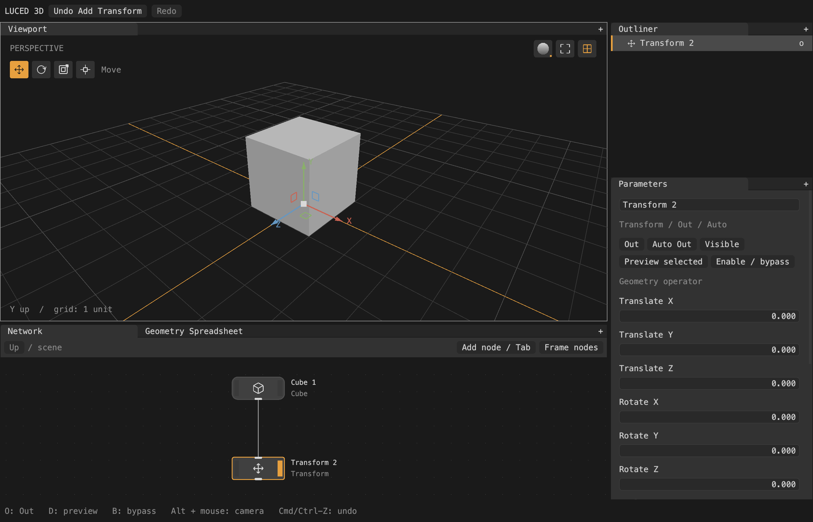

# Editor and engine design

`luced-2d` is the application reference: workspace state is separate from the
viewport, `luce-ui` provides dock panels and controls, and shared `Command`
instances drive keyboard and button actions. Signal connections are retained
and disconnected at shutdown. The theme reproduces its grey/orange palette using
the same linear-light conversion in `luce-color`.

    luced-3d → luce-ui   → luce-3d (SceneView)
             → luce-3d  → luce-gpu
             → luce-cad  → luce-3d
             → luce-step → luce-cad
             → luce-obj, luce-fbx → luce-3d
             → luce-prism

The application implements no native graphics backend. `luce-gpu` owns GPU
resources and submission. `luce-3d` owns topology, geometry operations, cameras,
materials, picking and rendering; it has no UI dependency. `luced-3d` owns the
graph, evaluation policy, operation recipes, selection, interaction and history.
The viewport hosts `luce-ui`'s `SceneView` widget, which connects a `Viewport`
to a `luce-3d` `Renderer`. The Metal observer under `tools/` is only
for test captures, following `luced-2d`'s preview workflow.

## Graph and evaluation

`network.luc` defines stable-ID nodes and ordered geometry input ports. Outputs
can fan out; Merge combines inputs. A proposed connection traverses upstream
dependencies before committing, rejecting self-links and cycles; evaluation also
detects cycles defensively. Missing inputs yield a visible node error. Deletion
disconnects consumers, so no dangling IDs remain. The workspace supports up to
128 nodes and 16 Group levels (see [OUTLINER.md](OUTLINER.md)).

Selected and displayed node IDs are independent. Disabled operators pass through
their first input (including Merge); disabled generators return empty geometry.
An invalid displayed branch clears the old mesh rather than pretending it is the
current output. The grid and the viewport's own shading lights are helpers
outside the user's graph; scene cameras and lights are nodes (below).

The DAG carries `GeometryData`: polygon and CAD components, including mixed
results from Merge, and Group instance branches. Transform preserves analytic
control nets; Null, Switch and bypass preserve the payload. Polygon-only tools
reject untessellated CAD with an explicit conversion message; CAD is never
silently tessellated.

## Cameras, lights and rendering

Cameras and lights are luce-geocore's `scene` component, so they travel in
the geometry: Transform places them, Merge joins them, Group instances them and
Blast filters them by path. The Scene root holds context containers, cameras,
lights and renders. Their parameters follow USD (UsdGeomCamera; UsdLux's rect, disk,
sphere and distant lights), and each looks or shines down its local -Z.
`GeometrySet.scene()` flattens a result and its instances to world space.

- **Camera** and **Light** (`scene_nodes.luc`) are objects at the root with no
  input: each makes just its object (a data network reads one through an
  Import node). Their Translate and Rotate use Transform's slots. Light's Type starts at Area
  (USD's RectLight).
- **Render** takes the root's flagged objects (it has no input) once they hold
  the camera of the Camera node its Camera row names by node path (blank:
  any camera; [NODE-PATHS.md](NODE-PATHS.md)), and warns when they have
  no lights. Its Engine menu
  chooses the renderer; the first is Luce Path, luce-render's spectral GPU path
  tracer (built on luce-gpu compute).
- The viewport draws a camera's frustum one unit deep and a light's emitter
  outline and direction with the guide lines (`OverlayLines.add_scene`).

Materials work the same way: they are luce-geocore's `materials` component, a
library of definitions (path, shader, named parameters) carried with the
geometry, and a face's material is its `material` text attribute, the binding
luce-usd reads and writes as `material:binding`.

- **Material** defines an OpenPBR material at a path; it adds to its input when
  connected, so a chain of Material nodes (or a Merge, or a Group of
  them) is a library.
  - **Inside it, shader nodes** (shader_nodes.luc). Double-click to enter: the
    menu offers shader nodes alone, and only a Material holds them.
  - **Its OpenPBR Surface** holds the material's parameters. Other nodes
    (Texture Coordinate, Position, Value, RGB, Image/Checker/Noise Texture,
    Math, Mix Color, Map Range, Clamp, Separate/Combine RGB, Color Ramp,
    Normal Map) drive its inputs.
  - **Sockets are typed**, values grey and colors or vectors orange. Nodes draw
    left to right with labeled sockets, and a link records which output it
    takes (`Node.sources`).
  - **Cooking:** the Material resolves its nodes into luce-render's graph text
    (`Network.resolve_material`), carried as the text parameter `shader_graph`;
    each engine compiles it (luce-render: an SVM-style program). Its stamp
    covers every node inside.
- **Assign Material** takes geometry and a library: the faces its Group names
  take the Material path (empty: the library's first), other faces keep theirs,
  and the library passes on with the geometry.
- **Render** has no input: it renders the root, every flagged object there
  ([NETWORK-LEVELS.md](NETWORK-LEVELS.md)), in the Render panel; faces with no
  material, or an unknown one, take its Default material.

## Background computation

Runtime node evaluation runs on a persistent worker. `Node.compute` receives
resolved inputs; the worker owns its graph mirror, CAD objects and cached results.
The UI never shares Luce objects with it.

- **Stamps** (`stamps.luc`). Before each request the UI stamps every node: a 64-bit
  hash of what its cook reads (kind, bypass, parameters, texts, Edit recipe keys,
  the file epoch and its inputs' stamps). Names, positions, display/output flags,
  visibility, selection and the Edit tool amount are excluded; visibility and
  output flags reach only the parent Group's stamp. An enabled Edit node's stamp
  is its input's stamp plus its recipe keys, so the state before a new recipe is
  already stored under the prefix stamp.
- **Requests** (`compute_request.luc`). The shared graph schema (`project_graph`,
  also used by project files) is framed as a Prism document: every node's header
  and stamp, but a body only when the worker's copy is stale, and each Edit element
  list once by content key. Requests queue in order as deltas; only the newest is
  cooked. A worker that loses its mirror asks for one full resend.
- **Result store** (`result_store.luc`). Cooked results, and failures of a node's
  own recipe, are keyed by stamp with an LRU budget of a quarter of physical
  memory. The displayed and selected stamps, their inputs and the Edit prefix
  before their last recipe are pinned. Renames, visibility toggles, the tool
  amount and undo/redo to an earlier state are store hits. An Edit node applies
  only the recipes after its longest stored prefix; a gizmo drag previews by
  applying its one recipe, one request per pointer move. Parsed files (by path,
  size, mtime, content hash and tolerance) and tessellations (by parsed model and
  options) are cached for the process in `node_evaluation.SourceCache`.
- **Cancellation.** A newer request stops publishing at the next checkpoint and
  cancels a cook only when it no longer wants the stamp being cooked; a
  still-wanted cook finishes into the store. Parsing and individual geometry
  operations are uninterruptible between checkpoints.
- **Publishing** (`display_publisher.luc`). Products are keyed by content: a
  displayed mesh by its stamp and ordinal, or by the identity of a mesh already
  published (an Edit without recipes, a Null or a bypass reuses its input's key).
  A published mesh is a new owner of the worker's immutable storage and its
  lazy caches (atomic owner counts), not a copy. Nothing is warmed for the UI:
  it picks on the GPU. Normal guides are extracted only while Show normals is
  on, as their own keyed products. The publisher keeps the meshes the UI holds (this result's and six
  recent keys), so a held key republishes with no work, and scene objects are
  rebuilt only when the displayed keys change.

Progress shows on nodes, including per-face CAD progress. The UI keeps the
previous scene visible while cooking; a 16 ms timer polls completion while idle.
Shutdown joins the worker.

## Edit recipes and undo

An Edit node stores ordered immutable `EditStep`s (a verb, its group and group
type, its numbers, symmetry and Keep selection); its kind (`edit_kinds.luc`:
Edit Mesh today) runs each step and says what its levels pick on. Each step
guards its input with the pick geometry's 64-bit topology hash. Changing an upstream transform or
dimensions preserves topology and replays edits; incompatible connectivity yields
an error with guidance. The latest extrusion distance can change without adding
an operation. Position-only edits share topology and display triangles with
their input, so Move works on tessellated CAD.

`history.luc` keeps before/after snapshots for up to 64 transactions. Graph
records and selection arrays are copied; immutable meshes and operations are
shared. `Workspace.perform` is the mutation boundary; rejected operations restore
the before snapshot. New commands after undo discard the redo branch. Parameter
scrubs and gizmo/node drags bracket one transaction; Escape or lost capture
cancels. Undo never recooks when the target state is in the result store.

## Gizmos

A Box node's corner handles resize it in its own frame while holding the opposite corner.
Transform and Group offer Move, Rotate, Scale and Pivot through viewport icons or
W/E/R/P. Move and Pivot use world axes and XY/XZ/YZ plane handles; Scale follows
the node's rotation; Rotate edits Euler components. Center handles give free
movement and uniform scale. Pivot movement compensates translation to preserve
the geometry, including rotated, non-uniformly scaled nodes.

Shift snaps movement to 0.1 units, rotation to 15 degrees and scale to 0.1
steps; plus/minus resize handles. Hover and active handles are orange; axes use
muted red/green/blue. Axis labels outside the viewport are culled. Gizmo drawing
and picking live in `node_gizmos`/`gizmo_math`, independent of evaluation.

## Viewport and rendering

- `luce-gpu.Geometry` retains immutable vertex and endpoint buffers; camera
  changes send a small parameter block per batch, and a shared vertex shader
  projects geometry and expands constant-pixel-width lines. Large batches split
  below Vulkan's guaranteed 128 MiB storage-buffer range.
- The renderer keeps prepared data per geometry object, so unchanged objects
  survive scene changes; flat and smooth buffers are independent cached views.
  Toggling display modes or wire visibility never evaluates the DAG.
- `WireRenderer` expands endpoint pairs into constant-width triangles in clip
  space, clips the near plane and depth-tests. Surface fills reserve the wire
  footprint with a slope-scaled depth bias (`Renderer.set_wire_overlay`), so
  wires on sloping surfaces stay continuous while front surfaces still hide rear
  wires. Translation handles are drawn on top.
- Edit overlays (`EditOverlay` in luce-3d) keep retained wire, point and selection
  batches in Base; picking uses the retained screen projection confirmed by one
  ray. Edge picking tests the perspective-correct point nearest the pointer.
  With a soft radius the overlay also holds each point's soft weight (geocore's
  `selection_weights`, recomputed only when the selection, mesh or settings
  change) and draws the points it reaches in a falloff ramp.
- Five display modes plus normal guides; Wireframe is transparent line-only,
  Flat ignores `N`, Shaded consumes it. CAD patch boundaries have their own batch.
- Camera clip planes follow orbit distance for depth precision on large parts.
- Panes and cameras (`view_panes.luc`, `view_state.luc`): the viewport shows
  one pane or four (the viewport options' Layout row, Window › Four views, or
  Space tapped over a pane: Maya's layout, Top, Perspective, Front and Right).
  Each pane has its own view: what it looks through, its shading mode and its
  grid; selection, the analysis and display settings
  (`display_settings.luc`) and the network are shared. The pane under the
  pointer is the active one, the Workspace's `view` while it is handled, so
  every tool reads the pane it works in. Space with F makes the viewport
  fill the window (the other panels and the timeline hidden, their layout
  kept); Space alone pans only in the Network, as before.
- Among four panes the chrome is docked once over the viewport, as Maya's
  and Blender's single tool palette (`viewport_chrome.luc`): the levels, the
  context display, Frame (every pane), Grid (every pane) and Hulls buttons
  and the caption with the network's path along the top left, the tools
  down the left edge, snapping in the bottom left. Its events come before
  any pane's and leave the active pane as it is. Each pane keeps only its
  own view's controls on one row in its top right corner, the camera menu
  beside the shading button, with the navigation gizmo under them, smaller
  in a small pane (26 to 44 points across its radius).
- The tool shelf (`tool_shelf.luc`, `shelf_tabs.luc`, `shelf_context.luc`,
  `shelf_state.luc`) is the viewport panel's footer, not drawn over the
  panes: open, it takes its height from them, so picks above it stay the
  viewport's and its clicks never change the active pane; it is not
  focusable, and a tile's click hands the keyboard back to the viewport.
  Its button is chrome (button 700, right of snapping), docked once among
  four panes. Its tabs are rebuilt from the registry as the editor
  refreshes (MODELING.md, Selection and tools).
- As the four panes appear (and as a project opens) each orthographic pane
  frames the model alone, centered and whole, once its size is known (its
  next draw; `ViewState.fit_model`); Camera and Light glyphs count only when
  nothing else shows. F in a pane frames it as before, the glyphs too.
  Orthographic framing leaves a wider margin than perspective's (1.4 of the
  extent), the pane's buttons sitting over its edges.
- A pane looking through a Camera node does not draw that camera's glyph
  (Maya hides it there). Camera and Light glyphs draw from the displayed
  scenes, one batch each (`ViewportBatches.glyph_batches`), not in the
  control hulls' batch.
- Projection: luce-3d's `Camera` sees in perspective or orthographically
  (`set_orthographic`); every renderer, the grid (which faces the plane an
  orthographic view looks square at), lines, gizmos, picking, marquees,
  splats and fog follow it through `Projection`'s `screen`, `ray_origin`,
  `ray_direction`, `pixel` and `clip`. Lines over faces take the same depth
  bias in both projections: a share of the depth range, whose f32 precision
  is alike in both (luce-3d's mesh_pixels test draws wires on faces seen
  square on orthographically). The ground grid is depth tested: it hides
  behind a body standing above it and shows through none; a body that
  crosses the ground plane (a CAD box centered on the origin) has the grid
  in front of its lower part, as in Fusion. An orthographic view's height follows
  the orbit distance, so switching keeps the size of what is at the target;
  its eye stands far back so nothing near the target is cut away; framing
  fits the extent across the pane. Render mode renders orthographic views
  orthographically (luce-render's `look(..., orthographic)`).
- Each pane's camera menu (`camera_menu.luc`, top right): Perspective, Top,
  Bottom, Front, Back, Left, Right, and every Camera node, looked through
  with its lens and clip (`camera_views.luc`); moving that view moves the
  node, live during a drag and one undo step for it. Under it, Blender's
  navigation gizmo (`view_cube.luc`): a click on an axis ball looks from
  that side orthographically, a second click from the opposite one; a drag
  orbits, and orbiting an orthographic view returns to perspective.
- Entering a sketch (a Sketch node, an Edit CAD sketch, a sketch on a face)
  turns the active pane to look square at its plane orthographically, its
  axes upright; leaving it gives the pane its view back
  (`sketch_camera.luc`). The camera menu may switch to Perspective meanwhile.
- Projects keep the layout and every pane's view (`/scene/view` `panes`);
  `~/.luced-3d/ui.prisma` keeps them too, with each pane's shading and grid.
- Picking reads the renderer's GPU id pass (faces; points and edges on the
  picked face), read back once per view. Distance queries use an immutable
  triangle BVH built lazily on first query, shared by snapshots and refitted
  after Moves.
- Selected faces tint in the surface pass from one bit per face; the overlay
  outlines up to 20k of them.
- **Render mode** (the shading menu's Render, `render_mode.luc`) shows
  luce-render's progressive image of the displayed scene through the viewport's
  camera, at the viewport's size, as Cycles' or Karma's viewport does.
  - **The scene:** the worker publishes each displayed output's set beside its
    meshes (`ComputeChannel.scene`, keyed by the output's stamp), as a plain
    storage sharing its arrays (`GeometrySet.plain_storage`). CAD models stay
    on their owning thread; `render_geometry.luc` includes their cached viewport
    surface meshes, at the chosen CAD quality, with the same placements and
    visibility. The authored CAD stays analytic. Several outputs render as
    instances of one set.
  - **Settings:** the network's Render node (the selected one, else the
    first) gives the default material, bounces, color mode and light paths;
    the menu's Samples row caps the samples. Without lights the scene is lit
    by a grey sky, and the corner label says so.
  - **Restarts** cost only what changed (luce-render's RenderSession): a camera
    move or resize restarts the film; a recook compiles on a thread, and where
    only lights or materials changed the geometry, BLAS and TLAS stay on the
    GPU. While the camera moves the image renders at 1/2 to 1/8 of the size,
    chosen from the measured cost so a sample takes about 16 ms; 0.15 s after
    the camera stops it renders at full size and refines to the cap. Scenes
    with splats trace passes of 2^17 paths, so passes stay short.
  - **Compositing:** the rasterized scene draws first and lays down depth; the
    render's image covers its colors (an image draw leaves depth alone); the
    grid, guides, hulls, Edit wires (drawn again without surfaces), gizmos and
    tools draw over it, depth-tested against the raster. The display transform
    (exposure, neutral or standard) is the Render panel's (`ViewState`).
  - **Never blank:** the image shows only once it suits the viewport: rendered
    at the viewport's size (at full size or a preview's divisor) and the size
    unchanged for 0.15 s. Until then (the mode entered, a scene's first
    compile, a resize larger or smaller) the viewport draws exactly as Shaded
    does, splats and fog included; a resize being dragged stays shaded rather
    than flickering, and an image of the old size is never stretched over the
    new one. A camera move keeps the last image (same size) until the next.

## Imports

| Package | Scope | Not supported |
| --- | --- | --- |
| luce-obj | Shared positions, polygons, positive/negative indices, corner UVs/N; `Obj.write` | MTL/textures, curves, vertex-color extensions |
| luce-fbx | Binary and ASCII 6.1–7.7 scenes: hierarchy with full transforms, meshes with every layer element, materials, instances, curves | Animation, skins and blend shapes (rest pose), NURBS surfaces, cameras and lights |
| luce-step | STEP → CAD: shared edges, conics, rational splines, colors, unique rigid assemblies | General p-curves, repeated/mapped instances, automatic units |
| luce-cad | Analytic topology, NURBS/analytic trims, per-face previews, tessellation | Booleans, disconnected-shell healing, certified deviation |

File has Browse, a path field and explicit Reload; it performs no scaling or
tessellation. STEP produces analytic CAD (`Step.load_model` / `decode_model`;
convert with `CadModel.tessellate`); OBJ/FBX produce polygons. FBX places each
model's mesh by its world transform (see [MODELING.md](MODELING.md#fbx-files)). STEP files get
the per-File import tolerance described in
[CAD_TESSELLATION.md](CAD_TESSELLATION.md#tolerances-and-import-uncertainty).
Imports are whole-file (no streaming, no file watching). OBJ import preflights
counts before allocating and attaches attributes during mesh construction.

The node menu (Tab) is cursor-anchored: empty queries browse
categories, typing searches globally, arrows/Enter choose, Escape or an outside
click dismisses.
A right click opens `node_context_menu.luc`'s menu at the pointer (the
Outliner opens it on a node's row): on a node, Actions' Rename, Cut, Copy,
Paste, Duplicate, flags, Set Output, Group and Delete; on the canvas, Paste and
Create (`top_menus.node_categories`, the Create menu's submenus). Cut, Copy,
Paste and Duplicate live in `node_clipboard.luc`: the picked nodes, everything inside
them and the wires among them are written with `project_graph` (the project
serializer) together with stubs of the containers above them, so the text reads
back through `read_graph`'s checks; the text goes on the system clipboard
(luce-clipboard holds text only) and is kept in the window too. A paste checks
each node against the level (`node_catalog.refusal`), gives new ids and unique
names, rewires the copies among themselves, points relative node paths between
copies at the copies, and is one undo step. A cut copies, then removes the
nodes, as one undo step labelled Cut.
The menu bar's Create menu (`top_menus.luc`) lists the same kinds, from
`node_catalog.offered`, the one list both menus read; its items are Actions'
`add` commands, so they add exactly as Tab does. Modify lists Actions' commands
for the selection, enabled by `Actions.refresh`.

## Interaction modules

- `workspace.luc`: the editor's state (network, history, displayed geometry,
  component selection and level) and its transactions (`perform`,
  `begin`/`commit`, undo/redo); it cooks the graph (`rebuild`, locally
  through `local_cook.luc` or on the worker, `poll_compute`) and holds the
  viewport's panes (`view_panes.luc`; `view` is the pane acted on), the
  display settings they share and the viewport's line batches (`viewport_batches.luc`). Commands on it live
  beside it, each change one transaction: `node_commands.luc` (nodes, flags,
  wiring, parameters, Groups), `selection_commands.luc` (picking, walking and
  the selection level), `modeling_commands.luc` (tools as Edit steps or verb
  nodes, Tool → Select and Reselect, primitives, knife, moves, gizmo
  previews) and `placing_commands.luc` (placing on surfaces). Language rule:
  modules cannot import each other in a cycle, so commands take the
  Workspace rather than the Workspace holding them.
- `actions.luc`: shared `luce-ui.Command` objects and state-dependent enabling.
- `network_view.luc`: graph coordinates, pointer-centred zoom, pan, port hit
  testing, wiring, flags, node movement and drawing. It accepts Tab so focus
  traversal does not consume node search.
- `inspector.luc`: selected-node properties and Edit operation information,
  without replacing an active field's value while typing.
- `viewport_tools.luc`: component controls, selection overlays and handles,
  enabled by the selected/displayed node's capabilities.
- `view.luc`: the panes, each drawn by luce-3d's `Renderer` into its own
  region of the viewport through its own view, navigation, and the routing
  of events to the pane under the pointer.
- `panels.luc` / `app.luc`: composition, search palette, refresh and lifecycle.
- `node_catalog.luc`: node kinds, arity, parameter defaults/ranges and inspector
  metadata. `node_evaluation.luc` dispatches operators; `component_groups.luc`
  resolves component groups; `edit_operations.luc` owns replayable recipes;
  `geometry_sheet.luc` virtualizes the spreadsheet.
- The tool registry (docs/research/POLY-MODELING.md §3): `tool_record.luc`
  (`Tool`, `Pick`, `Invocation`), `tool_registry.luc` (every tool, from each
  home of declarations), `verb_tools.luc` (the luce-geocore verbs as tools)
  and `verb_rows.luc` (a verb's parameter rows, for its node and its tool).
  The Edit kinds' tool lists, the menus (`tool_menus.luc`), the marking
  menus, the right-click menu, Repeat, the icons and docs/TOOLS.md
  (`tool_docs.luc`) read it.
- `tool_shelf.luc`: the viewport's tool shelf, its tiles the menus'
  commands (`shelf_tabs.luc`).
- Projects and UI persistence: [PROJECTS.md](PROJECTS.md).

## Mesh representation

luce-geocore's `Mesh` separates shared points, polygon corner lists, per-face
normals, unique edges and optional validated display triangles. Topology is
immutable and shared across threads by atomic owner counts; attribute-only and
position-only edits share it. Ear-clipped triangles support concave polygons;
draw, pick and overlays use the same triangulation. Numeric attributes carry
point/face/corner provenance through topology changes (see
[MODELING.md](MODELING.md)). All operators validate inputs and create new
results; failure leaves the input unchanged.

## References

Blender's [geometry evaluation graph](https://github.com/blender/blender/blob/main/source/blender/nodes/NOD_geometry_nodes_lazy_function.hh),
[region extrusion](https://github.com/blender/blender/blob/main/source/blender/bmesh/operators/bmo_extrude.cc),
[draw manager](https://github.com/blender/blender/blob/main/source/blender/draw/intern/draw_manager.hh)
and [mesh batch cache](https://github.com/blender/blender/blob/main/source/blender/draw/intern/draw_cache_impl_mesh.cc)
informed cached demand-driven evaluation, region boundaries and retaining
geometry separately from view state. Houdini's
[network editor](https://www.sidefx.com/docs/houdini/network/nodes.html),
[wiring](https://www.sidefx.com/docs/houdini/network/wire.html),
[flags](https://www.sidefx.com/docs/houdini/network/flags.html),
[attributes](https://www.sidefx.com/docs/houdini/model/attributes.html) and
[Geometry Spreadsheet](https://www.sidefx.com/docs/houdini/ref/panes/geosheet.html)
informed the compact graph, independent selected/displayed/bypassed states,
the four attribute domains and a read-only inspector. Blender's
[mesh toolbar](https://docs.blender.org/manual/en/latest/modeling/meshes/tools/toolbar.html)
informed the component buttons; navigation follows
[Maya's Alt-button mapping](https://help.autodesk.com/cloudhelp/2026/ENU/Maya-Basics/files/GUID-941480C1-9BDA-4DB3-8EA8-113A0D6FAF1F.htm).
All implementations are original; no GPL source was copied or linked.

## Direction

Keep one graph context: subnetworks should package the same graph with exposed
inputs/outputs rather than adding separate modeling/material/animation modes.
Keep topology algorithms and acceleration in luce-3d; editor commands, recipes
and selection in luced-3d. Fields, instances, shader graphs and GPU geometry
processing are future work; current CPU preparation must not be described as
GPU geometry acceleration. Performance work is tracked in
[PERFORMANCE.md](PERFORMANCE.md).
