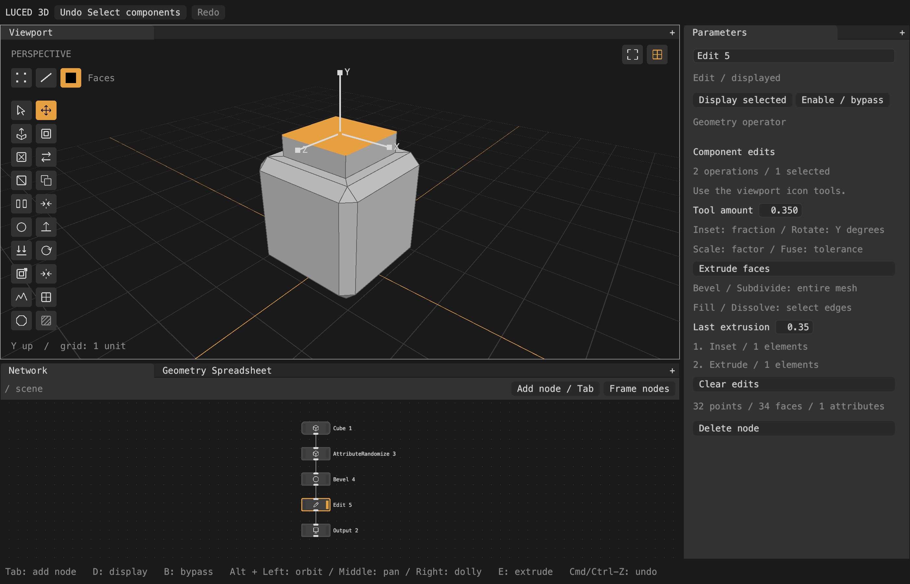

# Modeling capabilities

This is a substantial initial operator set, not Houdini or Blender feature parity.
No placeholder nodes are listed: every registered node evaluates geometry.

## Geometry nodes

| Family | Nodes |
| --- | --- |
| Sources | Cube, Grid, Sphere, Cylinder, Cone, Torus, File |
| Graph | Edit Mesh, Edit CAD, Edit SDF, Merge, Null, Switch, Tessellate, Group, Blast, Cache, Export |
| Transforms/copies | Transform, Mirror, CopyTransform, CopyToPoints, MatchSize |
| Modeling (verbs) | Delete, Reverse, Triangulate, Duplicate, Split, Inset, PolyExtrude, Subdivide, Fuse, Clean, PolyBevel, Loop Cut, Bridge, Fill, Dissolve, Merge Points; Subdivision (display) and Crease |
| Deformation (verbs) | Transform Components, Smooth, Mountain, Peak, Flatten, Snap |
| Curves (set verbs) | Curve Line, Curve Circle, Curve Arc, Curve Spiral, Resample Curve, Trim Curve, Fillet Curve, Reverse Curve, Set Curve Type, Curve to Mesh, Mesh to Curve |
| Volumes (set verbs) | SDF Sphere, SDF Box, SDF Torus, SDF Capsule, SDF Cylinder, SDF Boolean, SDF Modify, SDF to Volume, Mesh to SDF, Volume from Points, Convert to Mesh, Volume Slice |
| Attributes | AttributeCreate, AttributeRandomize, AttributeDelete, AttributeRename, AttributePromote, Selection Group, Normal, Measure, UVProject, Color |

Modeling and deformation nodes are luce-geocore verbs (after Houdini's SOP
verbs): one Base kernel per operation, shared with the Edit node. The node
catalog is generated from the verb registry, so each has the verb's
parameters plus Houdini's **Group** (text) and **Group Type** (Guess from group,
Points, Edges, Primitives, Vertices). An empty group is every element. Groups
use Houdini's group syntax with our functions (see luce-geocore's API):
`0 2-5`, `0-99:2`, `top ^left`, `@P.y>0`, `@name=piece*`, `p3-4-5`,
`grow(top, 2)`, `loop(p5-6)`. A group of another component type converts
(a face is in a point group when all its points are; Delete removes every face
using a deleted point, like Blast). Numbers naming no element match nothing.

A verb carries every attribute and group through its provenance: an element
with one parent copies it; an interpolated one (a subdivision edge point, a
new corner inside a face) averages floats, renormalizes normals, takes the
heaviest parent's integer or text, and keeps group membership only when every
parent is a member. New elements are zero, empty and in no group. Each verb
also returns an output selection (Extrude's front faces, Inset's inner faces,
Fuse's merged points), which the tool flow adopts.

Mesh operators work on the mesh component and pass every other component
through unchanged, as Houdini's SOPs do. That covers verbs, the Edit node and
the attribute nodes. The other components are curves, points, volumes, SDFs
and CAD beside a mesh; they are shared, so passing them costs nothing.

- A set with no polygons of its own passes through with a warning.
- A set of instances has its polygons realized first, as before.
- Attribute nodes also act on curves and point clouds. AttributeCreate,
  AttributeRandomize, Color, AttributeDelete, AttributeRename and Selection
  Group work there: curve vertices are their points, and primitives are
  curves.
- AttributePromote, Normal, Measure and UVProject are mesh-only. They warn
  and pass curves and points through.
- Mirror, CopyTransform, CopyToPoints and MatchSize place the whole set.

Curve nodes are set verbs: they run on the whole geometry set rather than the
realized mesh, and come from the same catalog (luce-geocore's `VerbCatalog`).
Curve points are the point domain and curves the primitive domain, so Group
and Group Type work on curves as they do on meshes. The viewport draws
evaluated curves in every shading mode, and their control hulls (control
polygons, Bezier handles, control points) behind the **Control hulls** toggle;
the hull overlay is generic, for any family's control nets. Curve to Mesh
takes an optional profile curve on its second input.

Volume nodes work on SDFs and sparse level-set or fog volumes, also as set
verbs. The viewport draws each SDF or level set by its surface preview, built
once per component. An SDF's preview lies on the exact surface. A fog volume
is drawn as smoke, as in Houdini's viewport: luce-3d's `FogScene` ray-marches
every `FogVolume` of the view on the GPU, lit by the key light (self-shadowed)
and the sky, veiling the meshes behind it, and ending each pixel's march
exactly at the nearest surface, so a mesh inside the fog is cut smoothly at
any depth. Grids whose boxes overlap march together, up to four a pass,
each sample summing them, so crossing smokes mix rather than one painting
over another, and shadow each other: the key light's and the sky's optical
depth at a sample runs through every grid covering it. Its texels are
made once per cook result (on the worker) and upload on the first frame, so
orbiting redraws without uploading. A **Volume Visualization** node (Houdini's)
sets how it looks, on the grids its Group names (each grid keeps its own
look, as Houdini's volvis attributes are per primitive): density scale,
smoke color, shadow scale, the ray-marching step; emission from a grid named
in its Emission field row, which then glows instead of being drawn as smoke
(the field times the emission scale; values of 0 or below emit nothing), in
one color or through the **Emission color ramp** row along the emission min
and max, read at the values of the grid in the **Emission color field** row
when it names one (Houdini's: temperature picks the color while another field
sets the strength), else at the emission field's; values outside the range,
negative ones too, take the ramp's nearer end; and a Density field row naming
a grid whose values show as the density. The grids' voxels stay shared, so a new look keeps the uploaded
texels; only the viewport's small table of looks and 256-texel ramp strips
goes to the GPU again. The `noise_cloud`,
`fire` (a ramp) and `two_smokes` (two tinted grids in one set) wrangle
examples show them. Convert to
Mesh makes real geometry of that surface. Volume Slice shows a colored plane
through the field: blue inside, orange outside, with contour bands.

Point clouds are drawn too. A cloud with Gaussian splat attributes (`orient`,
`scale`, `opacity`, `Cd`, `sh`; a 3DGS PLY through the File node, or Bake
GSplats) draws as Gaussian splats: luce-3d's `GaussianSplats` projects, culls,
evaluates SH and depth-sorts them on the GPU every time the view changes, and
draws them back to front over the scene, hidden behind meshes in front and
veiling those behind. Any other cloud draws as dots of its `Cd`. A cloud is
packed once per cook result (on the worker) and uploads on its first frame;
orbiting sorts again but uploads nothing. The shading menu's splat rows,
shown while splats are on screen, switch to **Centers** (dots; Wireframe
always shows centers, as Houdini does), cap the **SH degree**, raise the
**Alpha cull** and scale the splats; none of them recooks or uploads.

The **Cache** node (Houdini's File Cache) writes its input's cooked geometry
to a `.prism` file and passes it through. It uses luce-geocore's geometry
codec, which writes every component, attribute and group exactly. With
**Load from disk** it reads the file instead, and nothing upstream cooks.

The file records the node's stamp, and in read mode the node takes the stamp
recorded there. Two things follow:

- switching to read mode keeps every downstream result;
- while it reads, upstream edits stop at the node.

A 700k-face mesh saves in about 4 ms and loads in about 17 ms.

The **Export** node writes its input to the file its path names and passes
the input on. The extension picks the format:

- `.usda`, `.usdc`, `.usd` or `.usdz` (luce-usd): prims split by the `path`
  attribute, with **Root prim** for the rest (empty: `geo`) and **Precise
  points** for double precision;
- `.fbx` (luce-fbx): binary FBX 7.4, one model per `path` (see
  [FBX files](#fbx-files));
- `.obj` (luce-obj): the realized mesh;
- `.prism`: the geometry codec, as the Cache node writes it.

A cook writes the file, and cooks follow the node's stamp. A file is
therefore written when the input or the settings change. What USD cannot
hold, such as untessellated CAD, is left out with a warning.

## USD files

The File node reads `.usd`, `.usda`, `.usdc` and `.usdz` stages through
luce-usd's `Usd.load`, as luce-usd's docs/MAPPING.md describes:

- meshes, intrinsic shapes, curves and points are flattened into one
  component per family, each element carrying its prim path as `path`;
- point instancers become instances.

The USD rows:

- **Import**: *Flatten, keep instancing*, or *Flatten everything* to bake
  the instances;
- **Set time** and **Time**: the time values are read at (off: the stage's
  start time);
- **Render**, **Proxy** and **Guide** purposes;
- **Convert to Y-up meters**;
- **Subdivide as authored**: meshes without a `subdivisionScheme` are
  Catmull-Clark surfaces in USD.

Import warnings, such as dropped faces or skipped prim types, appear as the
node's warning.

## FBX files

The File node reads `.fbx` files (binary and ASCII, FBX 6.1 to 7.7) through
luce-fbx's `Fbx.load`, as luce-fbx's docs/MAPPING.md describes:

- every model's mesh is placed by its full FBX transform (pivots, pre- and
  post-rotation, rotation order, inherit type, geometric transform) and
  merged into one mesh, each face carrying its model's path as `path` and its
  material's name as `material`;
- normals, tangents, UV and color sets, smoothing, creases, holes and edge
  visibility become attributes; lines and NURBS curves become curves;
- animation, blend shapes and skins are evaluated at a chosen frame.

The FBX rows:

- **Import**: *Merge into one mesh*, or *Keep hierarchy* to keep each model's
  mesh in its own space, placed as an instance;
- **Instancing**: a mesh several models share loads once, as instances;
- **Convert to Y-up meters**;
- **Import normals**;
- **Set frame** and **Frame**: the first animation stack evaluated at that
  frame (off: the file's pose as saved);
- **Deform**: blend shapes and skins applied (skinned meshes are placed by
  their bones).

The Export node writes `.fbx` with luce-fbx's `Fbx.save`: the mesh split by
`path` into models (missing ancestors as nulls) with their normals, UV and
color sets, smoothing, creases, holes and edge visibility as layer elements
and `material` as materials; instances as models sharing their prototype's
geometry, placed by translation, rotation and scale; curves as lines and
NURBS curves; the `fbx.*` details (axes, unit, frame rate) as the file's
settings, else Y-up meters. Blender and ufbx read the files back.

## Selection and tools

Components can be selected on whichever node the viewport displays, at a
selection level (keys 1–5): Object (a whole piece: the faces sharing a
`path`, else a connected component), Polygons, Edges, Vertices (points) or
Corners. An Edit node shows its own kind's levels. The selection is a luce-geocore
`Selection` (bits plus the connectivity they index), so select all, invert,
grow, shrink, border, flood, loop and ring are word-parallel Base passes.
Switching the component type carries the selection over (a face stays when
all its points were selected).

Pressing a tool, as with Houdini's shelf tools:

- on the active **Edit node** (Edit Mesh), appends a step to its recipe (see
  below);
- on any other displayed node, creates the tool's verb node after it (between
  it and whatever it fed), with **Group** set to the selection's expression
  (runs such as `0-5 12`, a group's name, or chained edge pairs `p3-4-5`),
  **Group Type** set to the component type, and a **guard**: the connectivity
  hash the group was selected on. Display and the node selection move to it,
  and when it cooks its output selection (Extrude's front faces, Inset's inner
  faces) becomes the viewport selection, switching the component type. The
  Move gizmo on a plain node makes a Transform Components node the same way.
- with nothing selected, the new node waits (Tool → Select): the viewport picks
  on its input, and each change of the selection (a click, a box, Shift to
  add, Select All, Grow) becomes the node's group at once, its result shown;
  with nothing picked the input shows. Enter finishes, Esc removes the node.

If the input's topology later changes, a guarded node fails with "Group was
selected on different topology. Reselect, or Keep IDs." **Reselect** picks on the
input with the group selected, the node's result rewritten and shown as the
selection changes (Enter finishes, Esc restores the old group); **Keep IDs** clears the guard and
applies the numbers as they are (Houdini's behaviour). Typed groups are never
guarded. Very large selections show as a summary in the Group field.

## Edit tools and important limits

- PolyExtrude moves face regions (or each face, with Individual faces) along
  their averaged normals, with an inset across the region's boundary and
  divisions along the walls; each run of faces around a boundary point gets
  its own front point, and a whole closed surface simply moves out. An edge
  group extrudes its edges into quads (outward in the face plane on a mesh
  boundary) and selects the front edges. There is no twist, taper or spine.
- Inset moves the rim of each region (or face) inward by a distance, with an
  optional depth; inner corners blend their face's corners so UVs follow.
  Clamp keeps each move within half of the boundary edges beside it.
- Loop Cut cuts 1–64 loops across the quads of each group edge's ring (or
  only between the group's edges), slid together toward one side; other faces
  on the ring take the new points, and a quad already cut by one ring stops a
  crossing ring. The new loop edges are selected.
- Bridge joins pairs of boundary loops or runs among the group's edges (each
  with the nearest one of its kind) with rows of quads when they have as many
  edges, else with triangles zipped by distance along them. Loops are paired
  facing each other; coplanar holes twist. Twist turns where a loop starts.
- PolyBevel is Blender's bevel (docs/TOOLS.md lists its rows and keys): the
  group's edges become strips of 1–64 segments, their width measured as
  Offset, Width, Depth, Percent or Absolute, their profile a superellipse
  (Shape 0.5 round, 0.25 a chamfer, 1 square, 0 hollow) or a Custom profile
  ramp; corners fill with a grid patch (Grid Fill) or cut faces (Cutoff),
  with Sharp, Patch or Arc miters; Clamp overlap, Loop slide, Harden normals,
  Mark seams and sharp, Face strength, Material and the Angle or Weight limit
  (Bevel Weight sets `bevel_weight`). With points picked (or Affect
  Vertices) it cuts the points off. Non-manifold edges and points refuse with
  a message on the node.
- Subdivision marks a mesh to be shown as its Catmull-Clark (Loop, bilinear)
  limit surface at a display level; nodes after it still get the cage, and Edit
  edits the cage while the viewport shows the smooth surface. Crease sets USD
  edge sharpness for it. Picking selects cage faces (picked on the cage's
  shape, not the smooth surface).
- Subdivide operates on the whole mesh, Catmull–Clark or linear, with edges used
  by more than two faces kept as creases. There are no crease weights yet.
- Fill caps each closed loop of the group's boundary edges with one face, or
  (Fan) triangles around a new center point. Dissolve joins the faces across
  the group's interior edges, one face per region; a point group dissolves
  every edge at its points and removes points left between two edges.
  Regions with holes or pinches stay as they were.
- Fuse merges the group's points within a distance into the first of them,
  dropping faces that collapse. Merge Points merges them at their center, at
  the first or last, per connected island or by distance.
- A kernel that would make degenerate faces (a bridge between coplanar
  loops, say) passes its input through with a warning.
- CopyToPoints realizes copies at target positions, as many as there are
  points (CopyTransform, as many as asked), joined pairwise so a large count
  stays O(n log n). It does not yet interpret orientation/scale attributes
  or retain instances.

## Edit nodes

An Edit node is a modeling engine in one node: while it is displayed and
selected, every tool appends a step to its recipe instead of creating a node,
and each tool (or each drag) is one undo. There is no operation list to edit.
There is one Edit node per kind of geometry, so each keeps its own levels and
tools: **Edit Mesh** (polygons), **Edit CAD** (analytic models) and **Edit
SDF** (signed distance fields). They share one framework (`edit_types.luc`,
`edit_kinds.luc`): a kind supplies its selection levels, its tools and
primitives, the geometry each level picks on, the geometry its recipe starts
from, and the step executor that gives its verbs meaning; the recipe, undo,
checkpoints, the selection and its hand-off, the tool amount, symmetry, soft
selection and Keep selection, Tool → Select, the inspector rows, the level
switcher and the tool strip are the framework's. The tool strip and the
Create entries come from the kinds themselves: the strip shows what the
active kind offers (Edit Mesh's on other nodes). A kind may also show its
selection through surfaces (Edit SDF).

A step that cannot be built does not take the node down. The recipe stops
there, and the node keeps what the steps before it made. Its warning names the
step and says why, for example "Step 3 (Fillet) could not be built: a fillet
radius of 0.5 is too large for this curved edge: it must be less than 0.341".
The node shows WARNING, and the status line shows the displayed node's
warning. Undo the step, or change its values in the tool bar.

Any other node that fails shows ERROR and its message, and the status line
says "(the viewport shows its input)". The viewport then shows the nearest node
upstream that cooked, so a feature that cannot be built leaves the body it
started from on screen. That holds locally and on the compute worker.

Edit Mesh's levels are Object, Polygons, Edges, Vertices and Corners. At the
Object level a pick selects a whole piece, and moves, rotations, scales and
Delete act on whole pieces. Its tools are the tool registry's
([TOOLS.md](TOOLS.md), generated): each luce-geocore verb that declares a
section is a node in Geo and a step of Edit Mesh, from one declaration. A
tool is offered at the levels its pick takes (Bevel at Edges, Inset at
Polygons), and the menus follow:

- **S** (held in the viewport): Repeat, then the Modify tools the level
  takes, by family (Extrude, Bevel, Cut, Fill, Merge, Delete, …).
- **D**: Select, labeled columns of the Select tools the level takes, by
  family in the level's order (Loops first at Edges, Region first at
  Polygons and Vertices), then Selection (select all or none, invert,
  through the depth), the selection sets and Hide. D in the Network panel
  is the display flag. Every marking menu shows labels, a family per
  column under its name.
- **A**: the primitives and the drawing tools (PolyDraw).
- **Right-click** with components selected: Repeat, the same Modify tools
  by family, and a Select submenu; with nothing selected, Create and Select.
- **Modify ›** Edit Mesh tools: Repeat and a submenu per family; Modify ›
  Selection holds selecting all or none, inverting, a submenu per Select
  family, the sets and Hide.
- **Repeat** runs the last tool again on the new selection with its last
  numbers (as its tool bar left them, or its node's values when it made a
  node).

A Select tool changes the selection, not the recipe, one undo step: loops,
rings, face loops, boundaries, Loop to Region, Grow and Shrink, Connected
(with seam, sharp, material, UV and angle delimits), Shortest Path, Similar,
Sharp Edges, By Sides, By Area, By Normal, Non-manifold, Loose, Interior
Faces, Checker, Random, Mirror Selection and Convert (TOOLS.md lists their
rows). Its rows stay on the tool bar while its selection does, and a change
runs it again on the same selection (Blender's Adjust Last Operation). Each
is a group function too, so a node's Group can be a rule re-run on every
cook: `sharp(*, 30)`, `loop(p6-7)`, `sides(*, 4)`. The click gestures: a
double-click on an edge selects its loop (again on a boundary, the whole
boundary), on a face or point its island; Shift adds (a loop's run between
it and the edge picked last; the face loop beside the face picked last);
Cmd/Ctrl adds an edge's ring or takes an island away; Shift+Cmd/Ctrl takes
the loop or island away; Shift+Cmd/Ctrl+click adds the shortest path from
the element picked last. Hovering an edge shows, in amber, the loop a
double-click would take (its ring with Cmd/Ctrl).

Selection sets are named groups: Save as new set writes the selection as
`set1`, `set2`, … (in an Edit Mesh a Selection Set step, on a plain node a
Selection Group node after it), so they are kept in the project, survive
undo and ride through later steps; each set's submenu selects it alone,
adds, removes or intersects it, or writes the selection into it. Hide and
Hide unselected leave faces out of the viewport (not drawn, not picked,
never selected) until Unhide shows them selected; hiding is kept with undo
and ends when the mesh's topology changes. Besides the modeling verbs its
tools include
Knife (drag a stroke across the model, Shift snapping it to 15°: the cut is
the plane through the eye and the stroke, recorded as a Clip with its own
point and normal, cutting the selection or else every face under the stroke),
Connect (the tool amount places the new points), Edge Slide (the tool
amount is how far), PolyMirror (Polygons: across X through the origin,
welded), Spin (Edges: a full turn about Y in 12 steps), Crease (Edges: the
tool amount is the sharpness) and PolyDraw (Vertices: a face through the
selected points, ordered round their centroid and wound like its
neighbours). With nothing selected, PolyDraw draws: each click places a
corner on a point of the mesh (within 11 pixels), else on the surface
under the cursor, else on the ground; a rubber band follows the cursor;
Enter or a click on the first corner makes the face (one step with the
corners' positions), Esc cancels. It creates primitives (Box, Sphere, Cylinder,
Cone, Torus, Grid, Plane) as recipe steps: each new piece gets its own `path`
(`/box1`, `/box2`, …), becomes the selected Object and undoes like any step.
Unconnected, an Edit Mesh starts from nothing.

Edit CAD's levels are Object (a whole model), Faces (a B-rep face), Edges (a
B-rep edge), CVs (control vertices) and Patch. Object, Faces and Edges pick on
the models' display tessellations, tagged with their model, face and edge
(luce-cad's `CadEdits.pick_mesh`), so a pick selects a whole model, face or
edge; CVs pick on the control-vertex cloud, and show every face's control
net (a modeled face's too, hidden at the other levels). A step that meshes the faces again
keeps them selected (`CadEdits.carried`).

Edit CAD is Fusion 360's direct modeling ("Do not capture design history"):
every tool is a step on the model the steps before it made, nothing earlier
changes when something later does, and each step is one undo that gives the
model back exactly.

Its tools, and the CAD network's nodes, are the tool registry's too
([TOOLS.md](TOOLS.md)): each CAD tool is declared once in its
`src/tool_<name>.luc` (listed in `src/cad_tools.luc`), and that declaration
is its node, its Edit CAD step, its rows and tool bar, what it picks and in
what order (one prompt chain for a node and a step, `tool_picks.luc`), its
handles, its icon and its entries in the Create and Modify menus, the A and
S marking menus, the right-click menu and Repeat (`tool_run.luc` runs it).
A tool is offered at the levels its first pick takes: S and the right-click
menu list the tools the selection's level takes, by family (Blends, Faces,
Bodies, the surfacing families, Curves…), led by Repeat and Press Pull.

- **Sketches are objects of the model** (luce-cad's `CadSketches`, a component
  of the geometry set: name, text, plane, visibility; the Outliner lists them).
  **Create Sketch** (right-click, A, Create) makes one on the selected flat
  face, its loops projected once when it is made, or on an origin plane, and
  edits it at once with the Sketch node's editor; **Finish Sketch** leaves it,
  **Edit Sketch** edits one again, **Show/Hide Sketch** shows it or not.
  Drawing changes the step that made the sketch while it is the recipe's last,
  else adds an Edit Sketch step. Extrude and Revolve from the sketch (its
  picked profiles, else its closed shapes) are steps with the nodes' rows,
  arrows and value box; Auto cuts into a model, else joins the models it
  touches, else makes a body. A feature hides its sketch, as Fusion's does,
  and editing the sketch later leaves the feature as it was.
- **Faces and bodies**: the gizmo's Move at the Faces level moves and turns
  faces, the faces around following (whole models are placed at Object);
  **Move/Copy**'s tool bar is Fusion's dialog: Move type (Free move,
  Translate, Rotate about an origin axis or a picked edge, Point to point,
  Point to position, whose points are clicked as the type is chosen), the
  pivot (the selection's middle, the origin or a point) and Create copy
  (bodies, or faces as a surface body);
  **Press Pull** is Extrude in a sketch, Offset Face on faces and Fillet on
  edges; **Offset Face**; **Delete** removes whole models and heals faces (a
  hole, a boss, fillet, chamfer and corner faces, several at once: the faces
  around extended to close the gap; refused with why otherwise); **Remove**
  takes bodies away as a step of its own; **Remove Faces** leaves the model
  open; **Replace Face** (several target faces, Shift adds, Enter; Tangent
  chain), **Split Face**, **Combine** (its target lit while it waits) and
  **Split Body** wait for their targets, tool bodies or splitting face (the
  splits may take an origin plane from their tool bar); **Shell** opens the
  faces picked (a whole model: a closed void), with Tangent chain, Inside,
  Outside or Both (a thickness each way). A sketch's plane is changed with
  **Redefine Sketch Plane** (onto the selected face, or a face clicked or an
  origin plane from its tool bar).
- **Fillet and Chamfer** of picked edges run the nodes' own code, their radius
  arrow and tool bar as the nodes'. CVs move with the gizmo, Rotate, Scale,
  Noise, Flatten and Snap; a moved boundary CV takes its trims along.
- **The CVs level** (surfacing Stage 1, `edit_cad_nets.luc`; luce-cad's
  `nurbs/`), as Alias's Transform CV, its settings in one place in the
  Parameters panel (shown only at this level):
  - **Move modes**, a row under the levels (the Edit CAD node's CV move):
    World; NUV (the gizmo's axes become N, U and V at the first picked CV,
    and each CV moves in its own frame: its surface's normal and U and V
    tangents at its Greville point, as Alias's and Rhino's); Slide (along
    each CV's hull polyline, staying on it); Project (along each CV's hull
    lines, off the polyline); Parallel (every CV along the first one's hull
    lines); View (the screen plane). A drag's frame is fixed when it
    starts, and the hull as it was then is drawn as a blue ghost under the
    moving one (Alias's Proxy Display).
  - **Falloff**, one control (Alias's Proportional Modification), each kind
    showing only its own rows: Radius (Soft radius and Radius curve), Rows
    (Rows U and Rows V before and after each picked CV on its net, Alias's
    Preceding and Succeeding, weighted `(1 - k / (rows + 1))^e` with Falloff
    exponent e from -5 to 5: 0 moves them fully, negative values push them
    the other way) or Hull (a distance along the hull lines, Plasticity's).
    World with Radius falloff stays a Transform Components step; the rest
    make a **Move CVs** step.
  - **Symmetry** mirrors every CV move across X, Y or Z: a moved CV's
    mirror partner moves as its reflection, a CV on the plane stays on it.
  - **Step size, Drag strength, Lock X/Y/Z** (Alias's step and locks,
    Rhino's drag strength): a drag's move is scaled, taken in steps and
    kept off the locked axes of the mode's frame (N, U, V in NUV). With the
    Move tool on and CVs picked, the **arrow keys** nudge them one step
    (the grid's without a Step size) along the gizmo's first axis (left,
    right), its second (up, down) or with Shift its third, one undo each;
    only while the viewport has the keyboard, the timeline keeping them
    otherwise.
  - **Hull picking**: a second click on a CV takes its row along V, a third
    its row along U, a fourth its whole net; with Pick hull rows the first
    click takes the row.
  - **Structure steps**, on the surface of the first picked CV (or face, at
    Faces and Patch), from the right-click menu, the S menu and Modify, each
    one undo with its tool bar: **Insert Knot** (Direction, Parameter,
    Times; Alias's click: while it is the last step, the isoparm under the
    pointer shows green on the surface in its direction and a click puts the
    knot there, `knot_place.luc`; Esc lets clicks select again), **Remove
    Knot** (within a Tolerance; the knot line nearest the pointer is lit and
    a click removes that one), **Raise Degree**, **Rebuild** (Alias's types:
    Explicit, Within tolerance, Reduce spans, Del multi knots, Non-rational,
    Bezier; Explicit Control: multi-span quintic by default, a single span
    of degree 7, or Custom degrees and spans; Keep U ends and Keep V ends
    hold G0 to G3 with what the edges meet, G2 by default) and **Convert to
    B-spline** (an analytic face, at Faces and Patch; a sphere's cap is
    split through the axis first). The tool bar's last line says what the
    step did: "Rebuilt: degree 5 by 5, 4 by 4 spans; the surface moved at
    most 0.0012".
- **Curves** (surfacing Stage 2, `edit_cad_curves.luc`; luce-cad's
  `curves/` and `cad_curves`): free 3D curves, blend curves and curves on
  faces are objects of the model beside its bodies and sketches (named
  Curve1, Curve2…, listed in the outliner), drawn white, their control
  polygons with the nets at the CVs level, where their control points move
  with every mode above.
  - **Drawing** (the A menu, Create › Curves, the right-click with nothing
    picked): **CV Curve** (clicks place control points), **EP Curve**
    (clicks the curve passes through) and **Curve on Surface** (clicks on
    one face: the curve lies on it, its chart curve through the clicks);
    Enter finishes; degree 5 by default (the tool bar's Degree).
  - **The Curves level** (key 7) picks whole curves. On picked curves (the
    right-click, S, Modify): **Blend Curve** (two curves, from the end of
    the first nearest the second to the end of the second nearest the first,
    or their other ends; Start and End continuity G0 to G4, degree 5 on the
    spans the ends need, Extra spans, each end's tangent, curvature, rate
    and G4 shape), **Attach** (Blend at Blend bias with G0–G3, or Connect),
    **Detach** (at a parameter), **Close** (Preserve shape), **Stretch**
    (Locked or Floating; its handles stand on the curve, two at its ends:
    dragged in the plane facing the view, Shift-click on the curve adds one
    anywhere, up to degree + 1, Shift-click on a handle takes it away,
    `stretch_handles.luc`), **Reverse**, Delete.
  - **Blend Curve's handles** (Alias's blend point handles,
    `edit_cad_curves.blend_handles`, drawn and dragged by
    `feature_handles.luc` on the step and on the Blend Curve node): at each
    end an arrow along the way the blend leaves it, its length the tangent
    (a third of the chord at 1), and at G2 or more a second arrow on from
    its tip, the curvature's lean; a click opens the value box.
  - **Isoparms picked** (Alias's isoparm pick): at the Curves level a
    double-click on a surface makes the isoparm through the point a curve
    of the model, selected (the Isoparm step: Direction U or V, the point),
    its source kept ("isoparm <face> u 0.37"), ready for Blend Curve,
    Project or Trim.
  - At **Edges**: **Duplicate Curve** (each picked edge as a curve, exactly)
    and **Blend Curve** between two picked edges; at **Faces** and
    **Patch**: Duplicate Curve of the face's isoparm (Direction, Parameter).
  - Curves show their own icon in the outliner (Node.curve_paths, carried
    from the worker), and the **Check** node combs them (Alias's Curve
    Curvature, `CadMeasure.with_curve_combs`), curves alone too.
- **Surfacing Stage 3** (`edit_cad_surfaces.luc`, `surface_ops.luc`;
  luce-cad's `CadSurfacing`), one step and one undo each, from the
  right-click, S and Modify menus (Modify › Surfaces in CAD networks):
  - **Project** (at Curves): the picked curves cast onto a face clicked next
    (Pick projection face), Along a Vector, the View (its direction kept
    from when the step was made) or the Normal (Pull); Both ways; Match
    original. Each piece is a curve on the face.
  - **Intersect** (at Faces, Patch): two picked faces (Curves on both), or
    one With a plane (origin, normal): the meeting curves on the faces.
  - **Trim** (at Faces, Patch): the face cut by its curves; a marker stands
    in each region (`trim_regions.luc`), a click keeps (Keep) or takes away
    (Discard) that region and a second click lets it go; Divide makes every
    region its own face; Show intersections marks the crossings green and
    the loose ends of curves that cut nothing red. A trimmed solid is an
    open body; each trim keeps the face as it was as a stage. **Curves**:
    On face, or Alias's 3D Trimming (every curve of the model Cast along a
    vector or along the normals as the trim runs); **Intersect faces** (the
    faces picked after the first, a Trim node's Cutting faces, cut it where
    they meet it); **Extend curves** (an end stopping short runs on along
    the face to its edge or the next curve). While it waits for clicks the
    node reads a neutral "waiting", not a warning.
  - **Untrim** (Last or All of the stages; a face with none back to its
    natural surface), **Trim Convert** (degrees, spans, Switch U/V, Keep
    originals; the tool bar's last line reports the surface and edge
    deviations) and **Shrink** (the B-spline's net cut to its trims).
  - **Stitch** (at Object: the picked bodies joined within Gap; joined
    edges keep the gap as their precision; a body closed all round becomes
    a solid; for export, Detach periodic and Detach single-curve
    boundaries) and **Unstitch** (every face of a body a body of its own).
  - The same eight are nodes of CAD networks (category Surfaces), their
    faces, curves and bodies picked as the Modify features' are
    (`tool_picks.luc`); a Trim node shows its markers while
    it is selected and displayed and keeps the clicked points, so its trim
    follows the body upstream.
  - The sketch's Blend Curve takes its control points from the same 3D
    kernel (luce-cad's Blend Curve in the sketch's plane), its continuity
    then kept by the sketch's constraints.
- **Surfacing Stage 4, Align** (`edit_cad_align.luc`, `align_ops.luc`,
  `align_view.luc`; luce-cad's `CadSurfacing.aligned`), Alias's Align with
  its whole option window:
  - **Align** (at Edges: a surface's edge; at Curves: a curve near its end)
    from the right-click on an edge, the S and Modify menus: the step takes
    the input, then waits ("waiting", with the prompt) for the master: an
    edge (Edges), a curve (Curves), a face for Project and U/V (Faces), or
    a double-click on a surface for a temporary isoparm (Alias's pick
    object: kept as the point, resolved to the isoparm through it running
    along the input's edge, drawn dashed yellow). A second master comes from
    the tool bar (Pick second align master).
  - The rows: Continuity G0–G3; Type Edge, Project (Vector, Curve on
    surface, Shrink to fit), U/V, Vector; Position influence; Tangent
    balance; Tangent, Curvature and G3 scale (start and end) with AutoScale
    G2 and G3; Extra CV rows and Blend factor; Partial (Start, End); Modify
    both; Explicit control (degrees and spans); Refine (Max new spans and
    the limits); Outer edge (Edge align or Skew, start and end angles);
    Attach point (curves); Proxy display; Diagnostic feedback. A tall tool
    bar stands at the viewport's left, the model in sight.
  - The viewport draws the aligned rows tinted by their order (edge green,
    G1 yellow, G2 red, G3 purple, extra rows grey) joined across by the
    hull's lines (a row off the surface reads as the control net it is),
    the input's whole hull as it was as a ghost with Proxy display (Alias's),
    and the edge dashed red when the limits are missed (then the node warns
    how far); the Tangent scale arrows at the edge's ends, the middle one
    that slides the whole row (both scales together, Alias's) and Partial's
    range arrows are handles. The report line is
    Alias's Diagnostic Feedback (gap, angle, curvature and G3 differences,
    start and end angles).
  - **Aligned rows stay aligned**: a Move CVs or CV transform step later in
    the recipe that moves a CV of the rows an Align set runs that Align
    again afterwards (the owner's rule), so the tangent row cannot be
    dragged off the tangent plane.
  - **Symmetry Align** (Alias's Symmetry Plane Align): the input's edge
    onto a plane square to X, Y or Z at an offset (Project for position),
    G0–G3 with its mirror half.
  - Both are CAD network nodes too (category Surfaces): Align's Input edge,
    Master and Second master picked as the Modify features' inputs, a
    double-click a temporary isoparm master; the node follows its input
    upstream.
  - Modify both works with any master for a curve: against a surface (an
    edge, an isoparm, a curve on a face, the face) the surface bends locally
    to meet the curve halfway.
- **Surfacing Stage 5, surfaces from curves** (`edit_cad_build.luc`,
  `build_ops.luc`, `build_labels.luc`; luce-cad's `CadSurfaceBuild`), at the
  Curves and Edges levels, from the right-click on curves or edges, the S
  and Modify menus:
  - **Square** (four boundaries, curves or edges, each Free, G0, G1, G2,
    Implied tangent, Implied curvature or Tangent angle; Blend Linear or
    Cubic; Explicit control), **Skin** (sections in order; degree, Closed,
    Start and End continuity G0–G3), **Rail** (generation curves, then one
    rail or two: Sweep mode Natural, Parallel or Vector, the two-rail
    transform Scale, Non-proportional scale or Rotate, Blend bias, each
    side's continuity), **Profile** (profiles, then a rail: Orientation
    Parallel, Radial or Surface normal; Transition Linear, Local, Global or
    Limited), **Set Planar** (closed curves in a plane, a curve inside
    another a hole), **Sheet Extrude** and **Sheet Revolve** (free curves to
    sheets), and **Extend** (a surface's edge, or a curve near its end:
    Linear, Natural, Soft or Reflective, by a length or a percentage,
    Merge).
  - A builder starts on what is picked, in the order picked; when it needs
    more it waits ("waiting", with the prompt) and each click adds a curve
    or an edge (a second click takes it out), Enter finishing (Square at its
    fourth); a double-click on a surface adds a temporary isoparm (Alias's:
    resolved to the isoparm through the point that fits the others: for
    Square the one whose ends meet the other boundaries', else the one
    along them). Project's and Blend Curve's node prompts take temporary
    isoparms the same way. While a builder waits, the curves, edges and
    isoparms it has are lit along their length in the accent color.
  - Edit CAD's **Project** with no curves picked waits for them (a click
    adds a curve, a double-click a surface's temporary isoparm; Enter goes
    on to the face to cast onto); **Blend Curve** at the Curves level with
    fewer than two picked waits likewise, the second finishing it.
  - The Stage 5 follow-ups (luce-cad MODELING.md, Surfaces from curves):
    Square's **1-3 / 2-4 boundary blend** and **influence**, **Rebuild** and
    **Colinear** per boundary, and corners whose walls disagree (a G1 cap on
    a box's four walls) handled in corner zones; Rail's **Spine** sweep mode
    (the spine is the rails' last pick), **Sweep pivot** (Closest, On curve,
    Off curve) with **Fixed curve**, and **Curve segments**; Skin's **Curves a
    section** (curve sets), **Surface type** (Single or Multiple surfaces) and
    **Proportional crown**; Extend's **Chain select**.
  - **Boundary labels** (Alias's; Plasticity's black circles): each
    boundary with a continuity of its own carries its label beside its
    middle (Square's four, Skin's start and end, Rail's sides); a click
    cycles it, one undo step, the same value as its row. Square's
    **Continuity check** measures the new sheet's edges against the faces
    its boundaries lie on and draws them as the Check node's.
  - All are CAD network nodes too (category Surfaces), their curves picked
    as the Modify features' inputs (Boundaries, Sections, Generation curves
    and Rails, Profiles and Rail, Curves, Extend's Edge); edges are kept as
    their faces and a point, so a node follows its input upstream.
- **Surfacing Stage 6, blends between surfaces** (`blend_ops.luc`, with the
  builders' picks in `edit_cad_build.luc`; luce-cad's `CadSurfaceBlend`),
  Edit CAD steps and CAD network nodes (category Surfaces), from the
  right-click (Blend Surface and Tube on edges and curves, Surface Fillet on
  faces), the S and Modify › Surfaces menus:
  - **Blend Surface** (Alias's Freeform Blend; Profile Blend with
    profiles): the first side (edges, curves or isoparms, a chain), Enter,
    the second side, Enter, profile curves or none, Enter. Each side G0–G3
    (a label on the model cycles it), its Shape (Lock shapes),
    Proportional crown, Flow control (Connect ends or Free), Modify range,
    Continuity check.
  - **Surface Fillet** (Alias's; Parasolid's face-face blend): the first
    set's faces, Enter, the second set's, Enter; Section G0 chamfer, G1
    circular, G2 or G3 curvature, Construction Radius or Chord, the size,
    each set's side flipped (also by a click on its "Set" label: Alias's
    arrow), Trim Automatic, Curves on surface or Off, Form factor,
    Continuity check.
  - **Tube** (Alias's Tubular Offset): one curve or edge (or a double-click
    for an isoparm), Radius, Normal and Tangent offsets, Flip, Variable
    (a middle and an end radius), Trim (Off, Curves on surface, Inside).
  - Surface Fillet also has Sections Bias (Bias factor) and Lead (Knee
    ratio), Curvature (Both, Side 1, Side 2, None) and Variable (a middle and
    an end size); Blend Surface Flow control Edge align, Interior edge align
    and Explicit control; Skin Flow control and Modify range, Rail Rebuild
    per curve and Colinear per rail, and Explicit control on Skin, Rail and
    Profile.
  - While they wait, their picks are lit (a face set by its outline) and
    the prompts read "Pick first side or set", "Pick second side or set".
- **Surfacing Stage 7, Fill Surface** (`fill_ops.luc`, through `blend_ops.luc`;
  luce-cad's `CadSurfaceFill`; named Fill Surface because Edit Mesh has a
  Fill): xNURBS's variational fill, an Edit CAD step and a CAD network node,
  from the right-click on edges and curves, the S and Modify › Surfaces menus.
  The boundaries (edges, curves or isoparms in any order; one edge of a hole
  takes the whole hole) cook at once and the step waits for more; Enter goes
  on to guide curves (a double-click on a surface adds a point guide), Enter
  finishes. Rows: Continuity (Free, G0, G1, G2; each boundary's label on the
  model sets its own, cycling the row's, Free, G0, G1, G2), Quad (an
  untrimmed four-sided face), Tension, Flatness, Boundary flow (Quad:
  Natural, Normal, Next, Adjacent), Guide continuity, Explicit control
  (degrees and spans), Refine and Most spans, the position, angle and
  curvature tolerances, Boundary labels, Continuity check and Show
  conflicts: where the boundaries' demands disagree (a corner whose
  neighbors' normals or twists differ, a stretch no surface meets) the
  model shows a red ring or line with what disagrees by how much, and the
  node a warning. Conflicts are gathered one mark a corner or a boundary's
  runs, their plates kept clear of each other and the boundary labels; the
  Continuity Check leaves the conflicting corners' zones out, and the report
  counts the boundaries met away from them. Domain (N-sided): Auto projects
  onto the loop's best plane unless a neighbor stands square to it, then
  molds (four sides onto the square, Quad); Projected refuses such a hole
  with "use Molded or Quad". Fill waits in its own prompts, "Pick fill
  boundaries" and "Pick fill guides".
- **Surfacing Stage 8** (`cad_blends.luc`, `blend_ops.luc`; luce-cad's
  `blend_shape.lucb`, `bridge_fillet.lucb`): the Fillet node's and step's
  Parasolid rows, a Conic for G1 (Rho, Rho relative, Middle radius, with its
  Rho), a G2 shape (Fusion, Depth and skew, Softness), Limits (Limit from and
  Limit to along one straight edge, capped by planes square to it), Setback
  (radii a corner's fillets stop at least from it) and Overflow (off: a
  fillet must fit its faces; on, the behaviours its **Smooth**, **Cliff** and
  **Notch** rows allow, tried in that order: rolling on over a split face or
  onto a round beyond it, a cliff-edge blend through the edge where the face
  ends, the next face trimming it); **Selection sets** (Fusion's: the edges
  picked are set 1 at Radius, sets 2 to 9 their own edges, Pick set k edges,
  and Set k radius, an arrow on each set's first edge; with Variable radius,
  set 2 is the constant edges its law runs into at corners); in Edit CAD,
  edges selected while a Fillet is the last step, the right-click's **Add as
  fillet set** makes them its next set; **Select blends** (right-click, on
  faces or with nothing selected: Parasolid's identify blends, the models'
  constant radius fillets selected at the Faces level) and **Reblend**
  (Press Pull on fillet faces, or Modify: the picked blends given another
  radius, the step's Radius starting at theirs; the blends meeting them
  keep their own); **Bridge
  Fillet** (Edit CAD step and node, right-click on faces: the first side
  set, the second, then after Enter the center set, "Pick center set"),
  tangent to all three, the sides trimmed and the center consumed;
  **Corner** (right-click on faces: the blends meeting at a rounded corner,
  Ball corner or Corner blend), the hole they bound found and filled by
  Fill, G1; Center adjust (Alias's) moves the patch's middle along its
  normal.
- **Stage 3 follow-up**: Trim's 3D Trimming draws the curves as they are cast
  onto the face (white) while it waits for its region clicks.
- Primitives are luce-cad's analytic solids: Box, Cylinder, Cone, Sphere and
  Torus. Faces a step makes are named for the node and the step's place in
  the recipe (`#<node>s<n>`), so later steps find them and two Edit CAD nodes
  in one chain never clash; an imported model's unnamed faces are named when
  the recipe starts.

The last step's handles, value box and tool bar rows are the nodes'; a step
that cannot be built says why under its rows and on the node, while the model
before it shows. The viewport's right-click menu offers what applies to what
is selected; the A and S marking menus and Modify › CAD features hold the same
tools (no plain key is taken for them).

Edit SDF's one level, Object, picks whole primitives of the SDF program. It
picks on proxies: each primitive's own shape placed by the transforms around
it, tagged `sdf_prim` (luce-geocore's `SdfEdits`). Their topology depends
only on the shapes, so a drag keeps the selection and consecutive moves
merge, and a subtracted primitive stays pickable; the selection also shows,
dimmed, through the surface. Primitives (Sphere, Box, Torus, Capsule,
Cylinder) are steps added to the program by Add. The gizmo moves, rotates
and scales primitives (the move composes into the transform placing each
one); **Add**, **Subtract** and **Intersect** set the boolean joining a
primitive to the shapes before it, **Blend** rounds that join by the tool
amount, and **Delete** removes primitives. A drag's frames show a coarse
surface (40 voxels across); the release shows the full one (128).

The **Sketch** node (inside a CAD node) is a 2D sketch on a plane, as in
Fusion 360: points, lines, circles and arcs held by constraints and
dimensions, solved by luce-cad (`CadSketch`, luce-cad's docs/MODELING.md,
Sketches). It keeps the sketch as text and solves it on every evaluation;
its result is the curves Extrude and Revolve read, with its input's bodies
passed on beside them: one body flows down the chain, so `Box → Sketch →
Extrude` is one wire, as Fusion's timeline is (a set holds one sketch's
curves, its nearest one's). **Plane** picks XY (as
from the front), XZ (the ground, as from above), YZ (as from the right) or
**Face**: a flat face of the body connected to its input, picked with
**Pick face** (one click on the body), kept by the face's name so the sketch
follows it as features upstream change the body. **Offset** moves the plane
along its normal; starting to edit (or a new face) turns the active pane to
look square at it, orthographic, and finishing gives the pane its view back
(DESIGN.md, Viewport and rendering).

Selecting a Sketch edits it and rolls the display back to it, as Fusion
does: the viewport shows the model as it was at the sketch. **Finish Sketch**
(the right-click menu, A, Create), or selecting another node or nothing,
shows the node displayed before again. While displayed and selected, it is
edited in the viewport (`sketch_editor.luc`,
`sketch_view.luc`, after docs/research/FUSION-SKETCH-STUDY.md). Its curves
draw blue while free, light when fully constrained and orange as
construction. The toolbar along the bottom has Fusion's **CREATE**, **MODIFY**
and **CONSTRAINTS** menus (tools not built yet show greyed); the squares at
the top left choose what Select picks: Points, Lines or Shapes.

- **Drawing.** Line (L) chains from its last end until Esc, a right click or
  a click on its last point; Rectangle (R) takes two corners and makes its
  sides level and upright; Circle (C) a center and a point on it; Arc (A) a
  center, a start and an end (counterclockwise); Point (P) one click. The
  cursor snaps to points (the new point is that point) and curves (a point
  on the curve), and a line drawn within 3° of level or upright becomes
  horizontal or vertical: the constraints Fusion infers. Cmd (Ctrl
  elsewhere) places freely.
- **The origin** (`sketch_origin.luc`): every sketch shows its origin point
  and its x (red) and y (green) axes across the view, as Fusion does. Where
  nothing of the sketch is under the pointer, Select, the constraint tools and
  Sketch Dimension pick them, and drawing tools snap to them (a rectangle
  begun at the origin has its corner there). They are made in the sketch only
  when something holds to them (luce-cad's `CadSketch.origin`: fixed, the axes
  construction lines), are never part of a profile, and are never deleted.
- **Constraints** take their entities in order, the first the reference,
  and apply when they have enough (or at once to a selection): Horizontal/
  Vertical, Coincident, Tangent, Equal, Parallel, Perpendicular, Fix/UnFix,
  MidPoint, Concentric, Collinear and Symmetry. One the sketch cannot hold is
  refused: "Sketch geometry is over constrained", and the dimensions and
  constraints it conflicts with are lit in the warning color (and what they
  hold) until the next change or Esc.
- **Sketch Dimension** (D) takes a line (its length), a circle (diameter), an
  arc (radius), two points, a point and a line, or two lines (their angle,
  or their distance when parallel), then a click to place it. It measures
  the sketch as it is; one that repeats or contradicts others is driven
  (shown in parentheses), the status line says so and what it repeats is
  lit (luce-cad's `find_dependent`). Each dimension is a
  row of the parameter panel (d1, d2, …) in the document's unit; a new value
  re-solves the sketch.
- **Dimensions on the canvas** are drawn as drawings draw them
  (`sketch_dimensions.luc`, laid out by luce-cad's `CadSketch.lay_out`):
  extension lines, a dimension line with filled arrows (outside when the
  ends are close), R and Ø leaders, an arc for an angle (an arc's sweep at
  its center), the value over a dark patch; driven ones muted and in
  parentheses. Labels laid out automatically keep off each other: one whose
  place another label takes, or whose lines cross another's label, goes to
  the other side or a row further out (round its circle for a radius); a
  label the user dragged keeps its place. Constraint glyphs keep off the
  labels and each other (below right of what they hold, else above, else to
  the left). Both are placed once per sketch change or view. A click on a label or
  its lines selects the dimension; a click on the selected one opens its
  value box on the label (Enter re-solves, one undo); a drag moves the label,
  one undo, kept in the sketch's text relative to what it measures. The
  right-click menu on a dimension has Edit value, Make driven / Make
  driving (refused, said, when it would over-constrain) and Delete
  dimension.
- **Value boxes while drawing** (`sketch_typing.luc`, after Fusion's
  heads-up boxes and SolidCraft's `sketch_dims`): once a shape's first point
  is down, boxes follow the cursor beside what they measure: a line's Length
  and Angle (from level), a rectangle's Width and Height (a 3-point one's
  Length, then Width), a circle's Diameter, a center point arc's Radius then
  Sweep, a polygon's Radius and Sides. Typing replaces the focused box and
  locks it; Tab locks it as it stands and moves on (Shift+Tab back); locked
  values steer the cursor; Enter places the point. Lengths read any unit and
  arithmetic ("1 in", "10 + 5 mm"), angles degrees. The locked values become
  the shape's dimensions in its undo step, as Fusion makes them: a line's
  and a 3-point rectangle's Angle against the sketch's x axis, an arc's Sweep
  an angle dimension on the arc, a circle's Diameter (Fusion's box for those
  tools). A polygon's Sides is how many sides it is made with: its corners
  stay on a construction circle and its sides equal, so it stays regular (a
  circumscribed one's sides also touch an inner circle, its Radius's).
- **Modify**: Trim (T), Extend and Break act on the curve clicked, where it
  is clicked (Trim takes the piece between its nearest crossings; a
  circle becomes the arc left). Fillet and Chamfer take two lines meeting
  at a corner, or the corner's point; the fillet's radius is then typed in
  its value box. Offset (O) takes the chain a clicked curve is part of,
  then a click to its side, that far away. Move/Copy (M) takes the
  selection (or what is clicked) from one click to the next, Shift copying;
  Sketch Scale takes a base point, a point and where it goes. Blend Curve
  waits for splines.
- **Select** picks entities (Shift adds, Ctrl/Cmd takes away) and drags
  points, the sketch solving as they move (one undo when released). A drag
  from empty space boxes at the level, as Fusion's: dragged left to right a
  window, what lies wholly inside it (the points inside it, whole curves, at
  Shapes whole chains); right to left a crossing, drawn dashed, what it
  touches too (at Shapes every chain it touches) (luce-cad's `CadSketch.select_box`
  on the box cast onto the plane), with the same modifiers; a plain box over
  nothing clears the selection. A click on a constraint's glyph or a
  dimension selects the constraint (they win over geometry,
  `sketch_glyphs.luc`, `sketch_dimensions.luc`). Delete removes the selected constraints and
  entities (and what is drawn on them) in one undo step, as the right-click
  menu's Delete does; X toggles construction.

Each finished action is one undo step: the editor works on a live sketch
read from the node and writes it back.

**Profiles.** Curves that cross split each other: every smallest closed
region is a profile, as in Fusion. While a sketch is edited its profiles are
shaded (`sketch_profiles.luc`, luce-cad's `profile_fills`), the one under
the pointer lit; at the Shapes and Smart levels a click inside a region, off
its curves, picks its profile (Shift adds or takes it away). **Extrude** (the
right-click menu, A in the sketch, Create) then makes an Extrude after the
sketch with those profiles (none picked: its closed shapes), shown and
selected, its distance box open by its arrow: the arrow stands on the
profiles along the plane's normal and its tip drags the distance, snapped to
the grid (Cmd frees it), one undo step. Extrude's and Revolve's **Operation**
is **Auto** by default: halfway along what they make, inside a body they
cut, else they join it (a new body without one), as Fusion does; Join, Cut
and Intersect act on the body flowing down the chain, or on the second
input's when one is wired. Extrude and Revolve take the sketch's
closed shapes by default (holes left empty, overlapping shapes joined), or
the profiles picked with **Pick profiles**: the feature's result shows while
a click in a region adds it or leaves it out (its outline lit); Enter
finishes. Picked profiles are kept by the curves round them, so they hold as
dimensions change; **Closed shapes** forgets them. A click off the regions on
a flat face of the body takes that face itself as an Extrude's profile.

**A finished sketch shown** (`sketch_shown.luc`): with its node displayed but
not edited, its profiles are shaded among the body's faces, and at the Faces
level and Smart a click inside one picks it over the face beneath (Shift adds);
at Smart its points and curves near the pointer win too. Its points show as
small squares, a picked one (and the one under the pointer) as the editor's
larger accent square. Extrude and Revolve
then take those profiles as in the editor; a line picked with them is the
Revolve's axis. A CAD network's sketches never show their curves' control
polygons (`cad_nodes.shows_curve_hulls`), nor its B-rep bodies their faces'
control nets (luce-cad's `hull_lines`), as Fusion draws neither; but Edit
CAD's CVs level, where those control vertices are edited, shows the nets of
the faces a feature made (a G2 strip's, a setback patch's) as well
(`Network.cv_nets`).

**Selection in a CAD network**, Fusion's: a box dragged left to right is a
window (what lies wholly inside), right to left a crossing (what it touches),
drawn dashed; in a sketch, an Edit CAD node and at every level. A waiting
pick prompt filters what is picked as Fusion's command inputs do: faces for
Pick face, object, start object, center face and faces, edges for Pick edges
and Pick axis, whole bodies for Pick bodies, whatever level (Smart too) is
chosen; the level caption says "only". The A and S marking menus lead with
**Repeat** and the CAD tool used last (its command again, or its node added
bare when nothing selected applies).

**The viewport's right-click menu** (`viewport_menu.luc`) offers what
applies to what is selected, or under the pointer when nothing is (it is
selected first): in a sketch, Delete for its selection, Extrude, Finish
Sketch, Revolve and its CREATE tools; in a CAD node, for a selected flat
face Sketch on face (a Sketch after the displayed node on that face, edited
at once), Extrude face (an Extrude of the face itself, its loops the
profile) and Press Pull; for selected edges Press Pull, Fillet and Chamfer (the blend
after the displayed node with those edges); else the CAD Create nodes. The
A and S marking menus and the menu bar's Create and Modify (CAD features)
hold the same entries (`cad_commands.luc`). No plain key is taken for them.

**Extrude, as Fusion's dialog** (`cad_features.luc`, `extrude_inputs.luc`).
Type: Extrude, or **Thin extrude** (a wall along the profiles' curves, open
chains too, Wall thickness wide on Side 1: inside a closed profile, left of
an open curve; Side 2: outside, right; or Center). Start: Profile plane, an
Offset along the normal, or **Object** (a face picked with Pick start
object, Start offset further on; from a slanted or curved face the end
follows its shape moved the distance on; one side). Direction: One side (a negative distance goes
the other way), Two sides (each with its own extent and taper) or Symmetric
(Measurement: Half length, the distance each way, Fusion's; or Whole
length). Extent per side: Distance, **To object** (the face picked with
Pick object, kept by name, plus an Offset past it, and Fusion's **Extend**:
To selected face, its surface extended; To adjacent faces, stopping on it and
the faces next to it, refused when the extrusion would meet another face
first or run past them; To body, the body it is on; Through body, out of
that body's far side) or **All** (through the body; Flip turns one side
round). **Taper angle** per side follows Fusion's
sign: positive leans the sides out, the profile growing along the
extrusion (luce-cad's own sign is the opposite, turned over in the node).
Start offsets work with every extent. Sides of different extents are built
apart and joined. **Objects To Cut** (Pick bodies at the Object level, or
Auto-select: every body) names the bodies Join, Cut and Intersect act on, by a
face of each; Cut and Intersect act on each body apart, as Fusion's do.

**Revolve** turns its profiles about an **Axis**: Picked (Pick axis: click a
sketch line, construction lines too, kept by its index so it follows the
line; or a straight or round body edge, kept by reference), or the X, Y or
Z origin axis; the axis is projected onto the sketch's plane, as Fusion's
Project Axis does. Type Angle, Full, or **To** (until a face picked with Pick
object, its surface extended; Flip turns the other way); Direction One side (toward the
sketch's normal; a negative angle the other way), Two sides (an angle each
way) or Symmetric (the angle each way, Fusion's). A Revolve made from the
sketch (right-click, A, Create) asks for its axis at once; while it waits the
node warns, showing the sketch, rather than failing.

**Modify features as nodes** (each its `tool_<name>.luc`, stage 7 of
docs/research/FUSION-CAD-UX.md): **Shell**, **Move** (Fusion's Move/Copy),
**Combine** (its tool bodies picked, or wired to the second input), **Split
Body**, **Split Face**, **Replace Face**, **Delete Face** and **Remove** go
in the chain like Extrude and Fillet. They keep their faces and bodies by
name and run Edit CAD's own steps on them, with Fusion's options as above.
The right-click menu (on selected faces), the S menu and Modify › CAD
tools make them after the displayed node, taking what is selected; a
node then waits for each input it lacks in turn (its input body shown, the
prompt in the viewport, "waiting" on the node with no badge), and each input
is a panel row with its pick button. A **Move** node of Free move or
Translate shows Fusion's whole manipulator (`move_manipulator.luc`): arrows
along X, Y and Z, a square in each plane between them, the middle square
moving in the view's plane and, for Free move, rings turning about each
axis. It stands at the pivot moved by Translate, so it follows the body as
it is dragged, and for Free move its arrows, squares and rings turn with the
body as Fusion's do: an arrow drags along the body's turned axis, a ring
turns it about that axis (the turn composed with the rotation it had, written
back as the X, Y and Z angles). Drags snap to the grid along the
manipulator's axes and to whole degrees (Cmd or Ctrl frees them), one undo
step each. **Split Body** and **Split Face** have Fusion's **Extend
splitting tool** (on): off, a picked face cuts only where it reaches (Split
Face: right across each face it meets, or refused naming the option).
**Delete Face** heals a rounded or chamfered top chain beside rounded
uprights (G1, G2, G3), a fillet or chamfer at a pin's foot or on a hole's
rim, and groups of faces apart at once, and **Replace Face** takes an open surface body's
faces on several surfaces as its target, or another body's faces matching
the replaced ones one for one (a top's tangent chain onto a copy's), that
body free to overlap.

**Where an added node goes** (`node_room.luc`): a node made after another
(a feature from the viewport, a menu or a marking menu) goes one row below
its input; whatever it would cover is pushed a row down, and what that
covers in turn, so a node inserted mid-chain (a sketch on a face with the
marker rolled back) shifts the chain below it down. No added node lands on
another; a node placed at the pointer on the network keeps its place and
pushes what it covers down.
The nodes keep the names **Move** and **Delete Face**, Fusion's own names
for these timeline features (its API's MoveFeature and DeleteFaceFeature):
Fusion's dialog title Move/Copy cannot be a node's name (no `/` in names),
and a plain Delete would read as the Delete key, which deletes nodes, and as
the Edit nodes' Delete step.

**The timeline strip** (`cad_timeline.luc`, stage 8) runs along the Network
panel inside a CAD network: the chain's features as icons in order, a
marker after the displayed one that rolls the design back when dragged, a
click to select, a double-click to edit (Fusion's Edit Feature: the marker
rolled to the feature while it is edited, its value box open; a
double-click on the node does the same), and a drag to reorder, which is
cooked first on a copy and refused with the reason when a feature that
cooked would break (a Fillet put before the Extrude making its edges).

**Press Pull** (right-click, the S menu, Modify › CAD features) dispatches
on the selection as Fusion's does: in a sketch it is Extrude; on faces an
**Offset Face** node (luce-cad's `CadDirect.offset_faces`: the faces moved
along their normals, the faces round them following, tangent ones moving
too); on edges a Fillet.

**Fillet and Chamfer, as Fusion's dialogs** (`cad_blends.luc`). Select
edges at the Edges level (a double-click takes a tangent chain), then
Fillet or Chamfer from the right-click menu, S or Modify: the node goes in
after the displayed one with those edges, its radius box open by its arrow.
Fillet's **Type** is Fillet (the edges picked, kept by the faces they lie
between), **Rule fillet** (All edges, or Between faces of two sets picked
with Pick faces and Pick other faces; Rounds, Fillets or both), its edges
found again on every cook so they follow the body, or **Full round** (a
center face picked with Pick center face rounded away whole, tangent to it
and to the faces across its longest pair of parallel or concentric edges:
flat, tapered or bulging sides, and curved ribs). Radius type: Constant,
**Chord length** (the distance between where the fillet leaves its two
faces), or **Variable** (Radius at the start of the edge or its tangent
chain, End radius at its end, Points between as "position radius" pairs,
positions fractions of the chain's length; G1, G2 or G3; a straight edge
ending at any flat faces, a chain round a flat face running out where it
stops, a loop between curved faces). Between the radii the law is Fusion's
(Smooth transition off, the default): straight between two, a natural spline
through more, held flat at an extreme and along equal radii; a closed loop's
runs through its Points only, round the loop, as Fusion's. Smooth transition
on holds each radius a moment at its point (Inventor's; Fusion has none). At
G1 with a Tangency weight of 1 the fillet rolls a ball, as Fusion's: along
a straight edge (a cone along a straight law, the balls' envelope along
another, its sections turning to a slanted end face) and round closed loops;
where the law is steep enough that the envelope would fold, the section
scales instead, as Fusion's does.
**Corner type**: Rolling ball (a ball at G1; G2 and G3 fillets stop where the
ball's would, r from a square corner, and a three-sided patch joins their end
sections, Fusion's), or Setback (the fillets stop short of the corner, 2 radii
or by Fusion's rule where radii differ, and a patch blends them; where inside
and outside fillets meet, a vertex blend). Where an inside and
an outside fillet meet with the corner's third edge sharp (a Y corner), or one
of a kind meets two of the other, the pair's section rolls round the lone one's
end, Fusion's rolling ball (a torus at G1, the section swept at G2 and G3). Continuity is G1
(Fusion's Tangent), G2 (Curvature: Fusion's own curve, its faces' B-spline
data matched) or G3; **Tangency weight** (Fusion's, 0.1 to 2, 1 the plain
fillet, constant or variable radius): more hugs the faces longer and turns
tighter in the middle, less is flatter; a G1 fillet with a weight is a conic
(Fusion's), its corners setbacks. Parasolid's sections (Stage 8): **Conic**
(G1) by Rho, Rho relative (0.5 the circle) or Middle radius; **G2 shape** by
Depth and Skew or by Softness; **Limits** (with **At overlap**, Parasolid's
overlap limit: only where the fillet fits its faces); **Setback** (radii, Setback
corners); the setback corner's **Corner edge shape** (G1, Alias's Corner Blend
Edge Shape: its curves on the faces as conics, 0.5 the circle) and, for Setback
and three-sided corners, **Corner fullness** (Alias's Pivot Curve Length Ratio:
its patch's bulge scaled, 1 the fairest fill; 0, the default, as Fusion's
corners);
**Overflow** with its Smooth, Cliff and Notch behaviours (Smooth rolls an inside
foot onto a wall's rounded top; Notch trims a fillet where a notch cuts under
one end, Fusion's). **Selection sets** (Fusion's
"+" in its Fillet dialog): Selection sets 2 to 9, each further set its own
edges (Set k edges, Pick set k edges) and Set k radius, an arrow on each
set's first edge; where radii differ at a corner, a setback corner. With
Variable radius, set 2 is the constant edges the picked edges' law runs into
at corners (a straight law runs in as Fusion's, a cone to a setback corner by Fusion's rule; any
other must end at their radius). A dome's rim fillets too (Fusion's torus at
G1), and a plane meeting a cylinder along it (a D-shaft's flat) at G1, G2 and
G3 under any weight (G3 too heavily weighted there is refused: its section
would cross the cylinder). G2 and G3 follow a curved face's curvature at their
contact, G3 its change too. A variable radius straight between two radii at G1
(weight 1) rolls a ball, its face a cone, as Fusion's. Tangent chain as
Fusion's.
Chamfer's **Type** is Equal distance, **Two distances** (Distance along the
first face, the one more of the picked edges lie on, such as a top round its
rim, else a curved face over a flat one, as Fusion's; Distance 2 along the
other; Flip swaps) or **Distance and angle** (leaving the first face at Angle
from its own tangent where the chamfer meets it, as Fusion's: on a dome's
sphere the contact's tangent, not the rim's). **Corner type**, where three chamfers meet
at a corner: Chamfer (Fusion's default: a flat face joins them), Miter (they
run on to a point) or Blend (the chamfers set back and one flat face closes the
corner, as Fusion's). A chamfer's distance on a curved face is straight from the
edge (a chord), as Fusion's; a dome's rim chamfers too (every type checked
against Fusion, domes cut at and off their middle, and a D-shaft's flat). In Edit CAD a
Fillet step blends the edges picked; the rule is the node's. Edges selected
while the Fillet is the last step become its next selection set by the
right-click's Add as fillet set (their own Set k radius row in its tool bar).

**Curve** and **Blend Curve** (`cad_curve_nodes.luc`; Curves in the CAD
menus): Alias's construction history for curves. Each passes its input on
with one curve added (named in its Name row, else `Curve<id>`), made again
whenever the input changes. Curve's Type: Through points or Control points
(typed x y z apart by `;`, degree 5 by default), From edge (a picked edge,
kept by its reference), Isoparm (a picked face, Direction and Parameter) or
On face (a picked face, the points typed in its chart coordinates). Blend
Curve takes its From and To curves picked in the viewport, the input's
curves at the Curves level or, when it has none, its edges (kept by
reference): so a blend between two of a body's edges follows them when the
body changes upstream. Its rows are Edit CAD's Blend Curve's (G0 to G4 each
end, degree, spans, the ends' shape).

**Check** (`cad_check.luc`; Inspect in the CAD menus, the S menu, and Check
continuity on the right-click menu for selected edges). Check is Alias's
continuity check and curvature combs, made a node. It changes nothing: its
input passes through, and the viewport draws what it measured over the
result. The measuring is luce-cad's `CadMeasure`, on the exact geometry
(luce-cad `docs/MODELING.md`, Measuring).

Its options:

- **Continuity**: G0 to G3, G2 by default.
- **Stations** per edge.
- **Thresholds**: Distance (G0), Angle (G1), Curvature % (G2) and Curvature
  rate % (G3).
- **Sharp edges**: off by default, which leaves creases out (faces at more
  than 10° all along the edge).
- **Combs**, with their samples.
- **Cross quills**.
- **Comb scale**: at 1, the longest quill is a tenth of the body.
- **Deviation**, against the second input, with Acceptable and Ramp.
- **Edges**: Pick edges or All edges. None picked means every edge between
  two faces.

What the viewport draws (`viewport_batches.luc` `check_batches`, published by
the worker like curves, drawn in `view.luc`):

- **Edges by result.** An edge that meets the continuity is green. One order
  short it is yellow, further short red.
- **Labels**, as Alias labels its continuity check on the model
  (`check_labels.luc`). At its middle, an edge carries a label in its color:
  the order it reached and the measure that decided it, which is the first
  order it misses, or the order asked for when it passed. "G2  κ 0.00%" is a
  G2 contact whose curvatures agree; "G0  90.00°" a crease, its normals 90°
  apart; "G1  κ 100.00%" a G1 fillet's contact checked for G2; "G0 ×" a gap
  wider than Distance. Gaps read in model units, angles in degrees, the
  curvature (κ) and rate (κ') differences in percent. The labels cross from
  the worker beside the lines.
- **Combs.** Curvature combs on curved edges are magenta.
- **Cross quills.** Each face's curvature across the edge is a blue quill at
  every station. Equal quills mean G2; a G1 fillet's jump from 0 to 1/r shows
  as two lengths.

The node's line in the inspector is the report: how many edges passed and
the worst gap, angle and curvature and rate differences. With Deviation on,
the body is shaded by its signed distance from the second input's surfaces,
as Alias's Deviation Map: green within Acceptable, red outside the reference
and blue inside, saturating at Ramp. The colors are a display overlay
(`GeometryData.tint`, a mesh the viewport shades in the body's place): the
output is still the CAD body, so it picks, measures and passes on as one. The report then leads with the
deviation's range, RMS and share within Acceptable. Zebra, Isophotes and
Curvature shading show the same surfaces.

**Analysis shading.** The shading menu's Curvature has a radius band: where
the smallest radius of curvature is under Min radius it draws magenta, and
over Max radius grey. **Draft** shades by the draft angle against a pull
direction (±X, ±Y, ±Z):

- green past the angle asked for;
- yellow within it either way;
- red past it facing away.

Both are luce-gpu's mesh shading (modes 6 and 7); their settings persist with
the other shading options.

**Handles** (`feature_handles.luc`). The selected Extrude, Revolve, Offset
Face, Fillet or Chamfer shows Fusion's manipulators where its cook placed
them (`handle_lines.luc`; the cook reports them through the worker like
Auto's choice, so the viewport never cooks to draw them): an arrow per
Distance side of an Extrude, from its start along the normal, with a taper
ring beside its tip (pulled sideways it sets the angle, out positive); an
angle ring round a Revolve's axis per side; Offset Face's arrow on the
face; a blend's radius arrow on its first edge, out of the corner. An arrow
is drawn at least 44 points long, as Fusion's manipulators keep their size on
screen, and a drag moves its value by how far the pointer goes along it. A drag
sets the value (lengths snapped to the grid's 1, 2, 5 × 10ⁿ, angles to whole
degrees; Cmd frees them), one undo step; a click on a handle opens its value
box there, which a feature just made from the viewport opens by itself.
While a drag fails (a radius too large) the handles stay where the last
good cook put them, the node says why, and the viewport keeps the last good
result.

**Sketches on faces.** Sketch on face makes a Sketch whose first cook
projects the face's loops, linked (purple): an Offset of a loop (one relation,
one dimension) follows the face as the body changes upstream. The editor
reads what the cook made (its plane, its text when projections moved, the
curves whose edge was lost) and never cooks the body itself; Project's cast
of the body's edges is made by the cook too (`sketch_node.shadows_text`).
A projection whose edge is gone stays where it was, drawn yellow, and the
node shows a yellow badge (red when it fails); select the curves and
right-click: **Re-link** (then click the edge to follow) or **Break link**.
**Project** brings an edge clicked, every loop of a face clicked inside (off
its edges; the face nearest the camera where several cast there), or, from
the right-click menu while Project is the tool, the body's outline (**Project
body**, Fusion's Bodies filter); all linked, and a face is remembered so the
edges it gains upstream come too. Projected curves and their points draw
purple. **Slice** (right-click in a sketch) cuts the body in front of the
sketch's plane away (display only, `slice_view.luc`): the body is sliced
(luce-cad's `CadModeling.sliced`), so its edges show round the cut, and the
cut is capped, drawn lighter with Fusion's diagonal hatch and a dark outline
under the sketch (`sketch_section.luc`, the cap's loops sent by the cook). A
body the slice cannot cut shows clipped and uncapped, said. Extrude's Operation row shows what
Auto chose ("Auto (Cut)"). An Extrude made from a sketch rolled back to goes
in right after the sketch, before the features after it, and keeps the
display, as Fusion's marker stays at the new feature; those later features
show again when selected.

**Units.** Lengths are kept in millimeters; the document shows and reads
them in its unit, millimeters or inches (Window → Project settings), kept with the
project. Every length parameter shows its unit and takes typed units
("25.4 mm", "1 in", "10 + 5 mm").

- A step is one verb run: the verb, the group expression and its type, the
  parameter values, the connectivity hash the group was selected on, and the
  node's Symmetry and Keep selection settings at the time.
- The recipe is the truth: undo restores a shorter recipe. The worker keeps
  the results after the last eight steps and every sixteenth (D18), so undo
  and redo inside that window cook nothing, and a deeper undo replays at most
  fifteen steps. Consecutive moves of the same components merge into one step
  (D19); each drag remains its own undo.
- After a topology tool the selection becomes what the tool made (Extrude's
  front faces); with **Keep selection** it is instead the selection carried
  through the tool (a new element is selected when all its parents were).
- **Soft radius** and **Falloff** (linear, quadratic, cubic, smooth) make
  moves, rotations and scales pull the points near the selection, by the
  distance to the nearest selected point. While the radius is on, the
  viewport draws every point it reaches in a ramp from blue (barely moved)
  through yellow to orange (moves fully); the weights come from the same
  Base kernel as the move (luce-geocore's `selection_weights`). Edit Mesh and
  Edit CAD's control vertices honor it.
- **Symmetry** (X, Y or Z) mirrors every tool: the group gains the mirror of
  each member (points, faces, edges and vertices matched by position within a
  ten-thousandth of the model's size), and moved points' mirrors move to the
  mirrored places; points on the plane stay on it.
- An upstream change that alters the input's topology fails the node: "Edit
  input topology changed. Undo the upstream change or clear this node's edits."
  Position-only upstream changes flow through the recipe.

## Attribute contracts

Domains are point=0, vertex/corner=1, primitive/face=2, detail=3 and edge=4.
Numeric tuples have 1–4 components, float or integral values; text attributes
index a shared string table; groups are flagged boolean attributes. Names are
unique within a domain; `P` is reserved for built-in positions. Matrices and
arbitrary field sockets are not implemented.

Topology builders carry output-to-input parent maps (see the verbs above).
Extrusion walls inherit the originating face. Merge unions
schemas and zero-fills absent attributes; conflicting types fail and the left
detail value wins. Promotion averages contributing floating values; integer
promotion chooses the first contributor. Original-domain attributes are retained.

`Cd` and `uv` are consumed by rendering with corner > point > primitive > detail
precedence. Shaded display consumes corner `N` when present (CAD tessellation
writes analytic normals); Flat uses face normals. Generic numeric vector attributes are not automatically transformed
as directions/normals. UVProject is planar XZ projection, not UV unwrapping.

The Geometry Spreadsheet is virtualized, horizontally/vertically scrollable,
sortable, filterable and pinnable. It displays selected-node geometry separately
from the display flag. Its Detail tab shows the mesh's counts and detail
attributes and the set's own detail attributes (one row, with or without a
mesh). It is an inspector/selection surface, not a direct cell editor;
modify attributes with nodes.

## Operator fidelity

Houdini's [Subdivide](https://www.sidefx.com/docs/houdini/nodes/sop/subdivide.html),
[Fuse](https://www.sidefx.com/docs/houdini/nodes/sop/fuse.html),
[PolyBevel](https://www.sidefx.com/docs/houdini/nodes/sop/polybevel.html) and
[Smooth](https://www.sidefx.com/docs/houdini/nodes/sop/smooth.html) are the
references for these operators, and each is broader than ours: Subdivide
motivated separate topology/position handling and linear attribute interpolation;
Fuse shows that merging points needs explicit attribute ownership (ours keeps the
first representative, and Clean is separate); PolyBevel follows Blender's
bevel in full (point bevels, per-edge weights, grid corner patches, miters);
Smooth has more controls than our amount-and-iterations neighbor relaxation. The
limits above document these differences rather than claiming SOP equivalence.
Fields should arrive as a deliberate type-system addition, not ad-hoc
expressions inside widgets.

## Remaining modeling milestones

Robust booleans, remeshing, UV unwrap, multi-node selection, wire insertion and
subnets remain future work.
