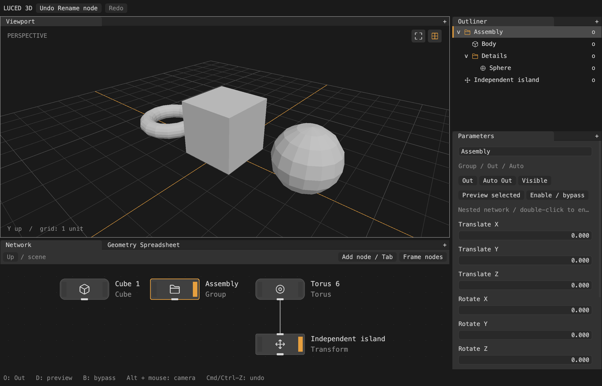

# Outliner and nested scene networks

The Outliner is a projection of the root scene, not a second editable copy of
scene ownership. Wires express data dependencies; container ownership gives
each node one parent. IDs remain stable through renaming, navigation and undo.

## Output rules

What each level yields, and so what the Outliner lists, is set by display
flags and Output nodes, after Houdini: see [NETWORK-LEVELS.md](NETWORK-LEVELS.md).
In short, the root (and a Group made there) renders every flagged node; Geo,
CAD, SDF, Volumes, GSplats and Groups inside them yield one output node (an
Output node, else the node with the display flag); Materials yields every
material. New projects open at Scene with a Geo containing a Cube, which holds
the Geo's display flag. Double-click Geo to model.

## Contexts and navigation

The scene menu contains Geo, CAD, SDF, Volumes, GSplats, Materials, Group, Camera,
Light and Render. Search and category browsing use the same context rules:

| Container | Contents |
| --- | --- |
| Geo | Mesh primitives, modeling, curves, attributes and material assignment |
| CAD | Sketches, solids and CAD features |
| SDF | SDF primitives, edits, booleans and conversions |
| Volumes | Grids, volume operations and conversions |
| GSplats | Splat operations, edits and attributes |
| Materials | Material definitions and library utilities |
| Material | Shader nodes |
| Group | The enclosing context; a root Group contains scene nodes |

Typed data networks also offer nested context containers and relevant utilities.
The grid generator remains named Volume; its container is Volumes. Enterable
nodes have a thicker outline. The rules apply to new authoring; old projects
retain their existing nodes, wiring and results.

Every spatial container and Materials has two external input ports. Connect a
source at the parent level, create Input inside the container and choose First
or Second. Wires remain local to one network. Material libraries can feed Geo
this way; Assign Material takes the imported library on its second input.
Creating a container does not automatically consume the previously selected node.

## Groups and navigation

`Group` owns a nested network and has translation, XYZ rotation in degrees,
scale and visibility. Double-click it in either Network or Outliner to enter;
the Network's Up button returns to its parent. The breadcrumb shows the scope.
The old attribute-mask Group operator is now named `Selection Group`.

Beneath a container the Outliner lists what it yields. Rows outside the
container the network view is in are greyed. Collapse arrows only affect tree
presentation. Clicking a name reveals its containing graph and selects it;
clicking the right-hand visibility control hides/shows the result.

Inside a Group the viewport edits that level in **local coordinates**, labeled
GROUP / LOCAL. At the parent level, Group transforms compose hierarchically.
This avoids applying world-space modeling deltas to local-space topology.
Entering hidden Groups still allows local editing. Navigation/collapse are not
history commands; graph edits, flags, visibility, transforms and recursive
deletion are undoable. Undo restores the editing scope captured with that edit.

## Evaluation and rendering

Groups in scene, Geo and CAD retain separate `GeometryInstance` branches in `GeometryData`.
Their child CAD/polygon payloads remain shared. The renderer creates engine
Groups with transforms; moving a Group does not regenerate child meshes.
Invalidation ascends containing Groups and then follows their data consumers.
Framing uses transformed bounding-box corners rather than merged geometry.

Geo, SDF, Volumes, GSplats and Materials pass what they yield on directly so
downstream nodes can read their typed payloads. Groups inside SDF,
Volumes, GSplats and Materials use the same rules.

Merge, Transform, Tessellate and pass-through nodes preserve instance branches.
Polygon-only operators explicitly realize the branches when requesting a mesh;
they still reject untessellated CAD. Visibility is presentation state and does
not remove geometry from that realization. CAD is never silently tessellated.

## Current boundaries

- 128 total graph nodes; up to 16 containment levels.
- Wires cannot cross network boundaries. Containers have two inputs and one
  aggregate output; arbitrary named interface ports are not implemented yet.
- Cmd/Ctrl+G groups selected nodes and their dependencies. Boundary Input nodes
  stay outside and feed the new Group through its ports. Drag-reparenting in the
  Outliner is not implemented yet.
- No dedicated Instance/reference authoring node, render visibility flag or
  object-level viewport picking yet. Select objects in the Outliner.
- The spreadsheet reports Group branches; it does not silently flatten them.
- A failed child causes its Group result to fail. Other top-level outputs still
  render. Parent transforms preserve child evaluation caches.

Tests cover display flags and output nodes (level_tests.luc), hidden rows,
nested evaluation, transform cache reuse, cross-scope rejection, deletion/undo,
preview independence, graph/Outliner double-click navigation and collapse.
`tools/preview.py --scene outliner` captures the native multi-output scene:

